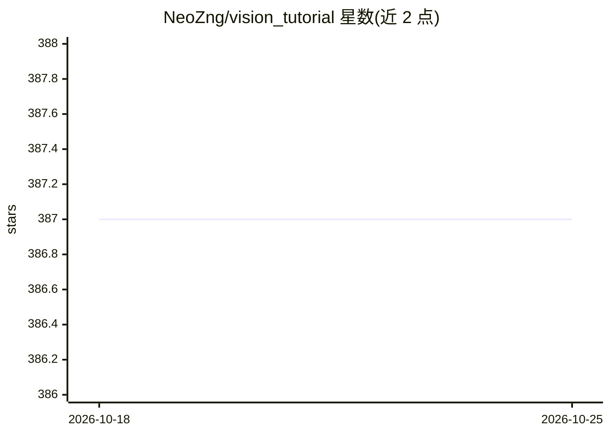

# NeoZng/vision_tutorial

⭐ 387 · Shell · MIT · 推送 2026-08-23 · [GitHub](https://github.com/NeoZng/vision_tutorial) · 个人维护 · 中文 README

**计算机视觉与 RoboMaster 入门教程及 OpenCV 练习代码仓库**

面向 RoboMaster 算法组新人的计算机视觉入门手册，包含教程文档与 OpenCV 基础 API 的练习代码。内容覆盖计算机视觉入门知识与图像处理实践，读者可通过 email 联系作者，仓库开放 PR 与 issue 参与。仓库未提供安装命令，使用方式以阅读文档和运行练习代码为主。

## 筛选速览

| 维度 | 判定 | 备注 |
|---|---|---|
| AI 角色 | `ai-knowledge` | 知识聚合/清单类 |
| 许可风险 | `permissive` | MIT |
| 部署形态 | `None` |  |
| 模型依赖 | — | README 未给出锁定关系 |
| 硬件要求 | — | 无带数字的原话,不猜 |
| 安装摩擦 | `low` | 无编译、无系统依赖或容器化 |
| 成熟度 | — | 结构信号不足 |

## 能力要点

- 计算机视觉与 RoboMaster 入门手册文档
- OpenCV 基础 API 练习代码

## 适用场景

- RoboMaster 算法组新人学习计算机视觉入门知识
- 通过练习代码熟悉 OpenCV 基础 API
- 作为图像处理课程的配套练习材料

## 场景标签

`教程课程` · 领域:学习与行业

## 证据(README 行号)

> L2: 本文档是计算机视觉和RoboMaster入门手册和opencv基础api的练习代码仓库。

## 星数曲线

2026-10-18 387 → 2026-10-25 387（+0）

---
*卡片 v1 · prompt 1.4 · 生成 2026-10-21 · 置信度 mid · 依据 README sha `f922fa6c38c8` · [字段定义](../../DATASET.md)*
