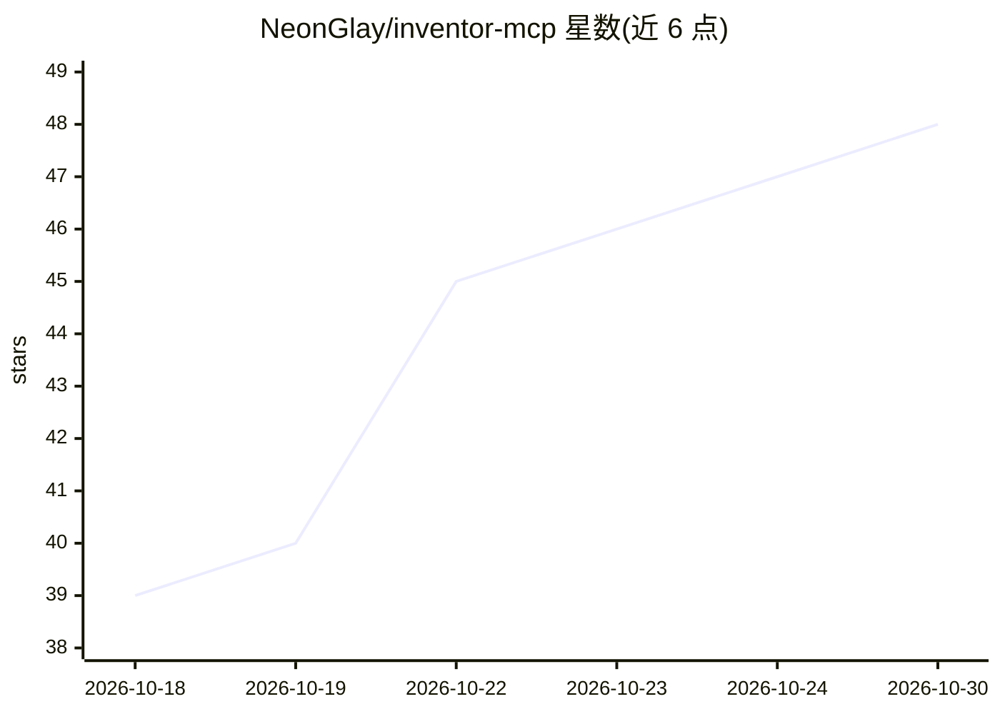

# NeonGlay/inventor-mcp

⭐ 48 · Python · MIT · 推送 2026-06-10 · [GitHub](https://github.com/NeonGlay/inventor-mcp) · 个人维护

**用自然语言驱动 Autodesk Inventor 参数化建模的 MCP server**

面向使用 Claude 等 MCP 客户端的工程师：将 Inventor 的 COM API 封装为 34 个毫米单位的 MCP 工具，覆盖草图、拉伸/旋转、孔特征、钣金、圆角倒角、阵列与参数。附带 execute_python 在持久命名空间执行任意 Python、事务回滚、热重载，以及每步操作的体积/拓扑变化自动报告供 AI 自检。内含两个 Agent Skills（建模流程与 DIN 标准件配方），并整理 Inventor 2026 COM API 的未公开经验知识（枚举值、FlangeDefinition 参数行为等）。仅支持 Windows，需本机安装 Inventor 与 Python 3.12+。

## 筛选速览

| 维度 | 判定 | 备注 |
|---|---|---|
| AI 角色 | `ai-ecosystem` | LLM/agent 周边工具 |
| 许可风险 | `permissive` | MIT |
| 部署形态 | `library` | 以包/库形式分发 |
| 模型依赖 | — | README 未给出锁定关系 |
| 硬件要求 | — | 无带数字的原话,不猜 |
| 安装摩擦 | `low` | 无编译、无系统依赖或容器化 |
| 成熟度 | — | 结构信号不足 |

## 能力要点

- 34 个 MCP 工具：草图、孔特征、钣金、阵列、参数等
- execute_python 在持久命名空间中直连 COM 的逃生通道
- 每次特征操作返回体积/拓扑变化供 AI 自检验证
- 整理 Inventor 2026 未公开 COM API 行为（枚举值、参数陷阱）

## 适用场景

- 通过对话让 AI 助手在 Inventor 中创建参数化零件
- 生成符合 DIN/ISO 标准的标准件（螺母、螺栓、法兰等）
- 多步建模操作的事务化与一键回滚

## 场景标签

 · 领域:CAD/AI 工具集成

## 证据(README 行号)

> L3: **MCP server for parametric 3D modeling in Autodesk Inventor — drive Inventor with Claude (or any MCP client) in nat
> L15: - **34 MCP tools**: sketching, extrude/revolve, native hole features (drilled / tapped / counterbore), fillets, cha
> L80: src/server.py        FastMCP server — tool definitions (stdio transport)

## 星数曲线

2026-10-18 39 → 2026-10-30 48（+9）

---
*卡片 v1 · prompt 1.4 · 生成 2026-10-25 · 置信度 mid · 依据 README sha `3bab509f8343` · [字段定义](../../DATASET.md)*
