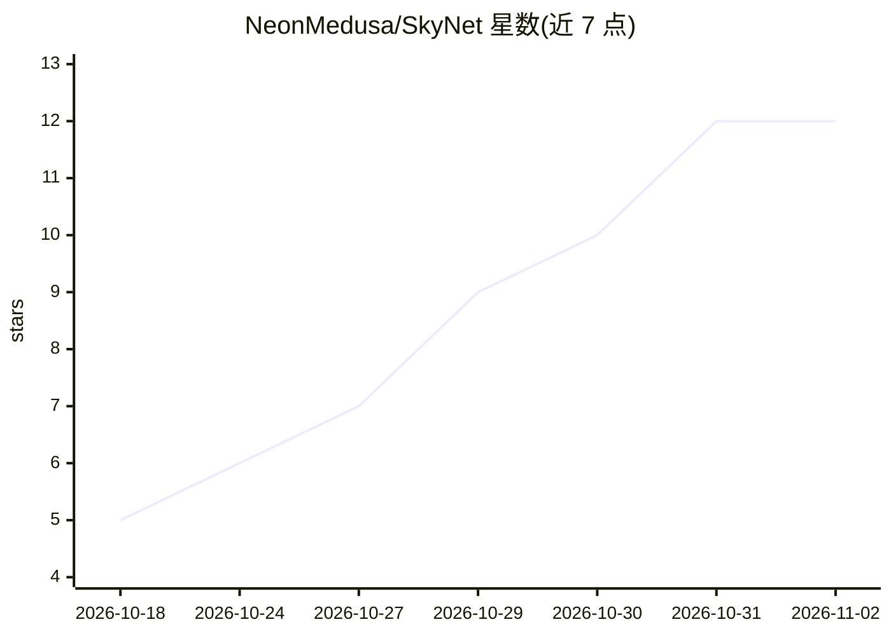

# NeonMedusa/SkyNet

⭐ 12 · Zig · MIT · 推送 2026-10-28 · [GitHub](https://github.com/NeonMedusa/SkyNet) · 个人维护 · 中文 README

**Zig 编写的终端 AI 编码助手，单静态二进制无运行时**

用 Zig 0.17 写的 TUI/CLI AI 编码代理，提供 read/write/edit/bash/grep/find/ls/cd/webfetch 共 9 个工具，支持流式对话、思考块、SQLite 持久化对话、上下文压缩与 prompt 缓存亲和。产物为单个约 4MB 静态二进制，平均内存占用 30MB 以内，Windows 日常验证、Linux（WSL2）已适配实测、macOS 未验证。明确声明无权限系统与沙箱、工具无确认环节；提供商仅实测 opencode-go 网关与 deepseek-v4.1-flash，其余 18 家内置预设为模板不保证可用。项目自述处于实验阶段，数据库结构随时可能变动。

## 筛选速览

| 维度 | 判定 | 备注 |
|---|---|---|
| AI 角色 | `ai-native` | 本体是模型或模型工具 |
| 许可风险 | `permissive` | MIT |
| 部署形态 | `desktop` | 安装包/桌面程序 |
| 模型依赖 | — | README 未给出锁定关系 |
| 硬件要求 | — | 无带数字的原话,不猜 |
| 安装摩擦 | `low` | 无编译、无系统依赖或容器化 |
| 成熟度 | `idea` | |

## 能力要点

- 单个约 4MB 静态二进制，无需运行时，平均内存 30MB 以内
- 9 个工具（read/write/edit/bash/grep/find/ls/cd/webfetch），CLI 与 TUI 共用 agent 逻辑
- SQLite 对话持久化、上下文压缩、prompt 缓存亲和、断流自动重试
- 18 家内置提供商预设与编译进程序的模型能力表

## 适用场景

- 在终端里让 AI 代为读写文件、执行命令、抓取网页完成编码任务
- 以无界面 CLI 子命令（ask 等）单轮调用并按退出码集成脚本
- 低资源环境运行轻量编码代理

## 场景标签

`编码 Agent` · 领域:编码与开发

## 证据(README 行号)

> L5: 用 Zig 0.17 写的 TUI AI 编码助手，仿照 pi 提供 9 个工具（read / write / edit / bash / grep / find / ls / cd / webfetch）：
> L71: ./zig-out/bin/SkyNet.exe ask -new -title "随便聊聊" "你好"    # 无界面发送一轮对话

## 星数曲线

2026-10-18 5 → 2026-11-02 12（+7）

---
*卡片 v1 · prompt 1.4 · 生成 2026-11-01 · 置信度 high · 依据 README sha `58e0f6e3dae3` · [字段定义](../../DATASET.md)*
