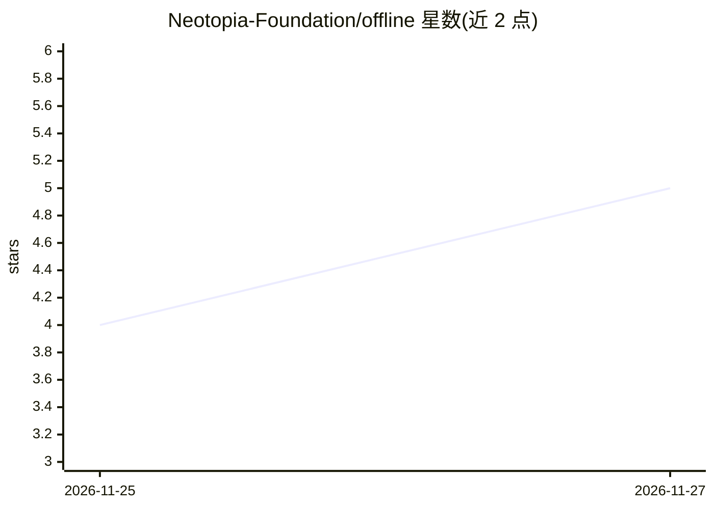

# Neotopia-Foundation/offline

⭐ 5 · Shell · NOASSERTION · 推送 2026-11-24 · [GitHub](https://github.com/Neotopia-Foundation/offline) · 组织维护

**一份 Markdown 指南，让 AI agent 为欧洲家庭构建离线应急资料库**

由 Neotopia Foundation 发布的测试版项目，交付物是一个 Markdown 格式的指南文件：用户将其交给能执行命令的 AI 编码 agent（Claude Code、Codex、Gemini CLI 等），agent 询问国家、语言、设备与磁盘空间后，按清单下载地图、Wikipedia 镜像、官方备灾指南与本地 AI 模型并生成启动页，构建完成后可在断网环境使用。含 SHA256 校验、BitTorrent 大文件下载（aria2c）、失败日志与离线演练流程。覆盖 48 个国家；Windows 构建未经测试；构建期间需联网。

## 筛选速览

| 维度 | 判定 | 备注 |
|---|---|---|
| AI 角色 | `ai-enhanced` | 去掉 AI 部分产品仍成立 |
| 许可风险 | `none` | NOASSERTION |
| 部署形态 | `desktop` | 安装包/桌面程序 |
| 模型依赖 | — | README 未给出锁定关系 |
| 硬件要求 | — | 无带数字的原话,不猜 |
| 安装摩擦 | `low` | 无编译、无系统依赖或容器化 |
| 成熟度 | `idea` | |

## 能力要点

- 单文件 Markdown 指南驱动 agent 构建离线资料库（地图/Wikipedia/备灾指南）
- 发布版 checksum 校验与 SHA256SUMS.txt 全盘校验，含失败项日志
- Kiwix 大档案可走 BitTorrent（aria2c）以节省镜像
- 按驱动器容量（32 GB–512 GB+）与机器内存选择内容档位与 AI 模型

## 适用场景

- 为家庭准备断电断网时仍可查阅的本地地图与百科
- 按国家与语言定制离线应急资料 U 盘
- 构建后做断网演练验证资料可用性

## 场景标签

`教程课程` · 领域:学习与行业

## 证据(README 行号)

> L10:  Give your AI coding agent one Markdown file. It builds an offline library for your part of Europe.
> L39: **2. Open your agent in that folder.** Claude Code, Codex, Gemini CLI or another agent that can run commands.
> L70: - **Local AI chat.** Copy a passage from Kiwix and paste it into the chat for an explanation. The model runs on you

## 星数曲线

2026-11-25 4 → 2026-11-27 5（+1）

---
*卡片 v1 · prompt 1.4 · 生成 2026-11-24 · 置信度 mid · 依据 README sha `d0e293743334` · [字段定义](../../DATASET.md)*
