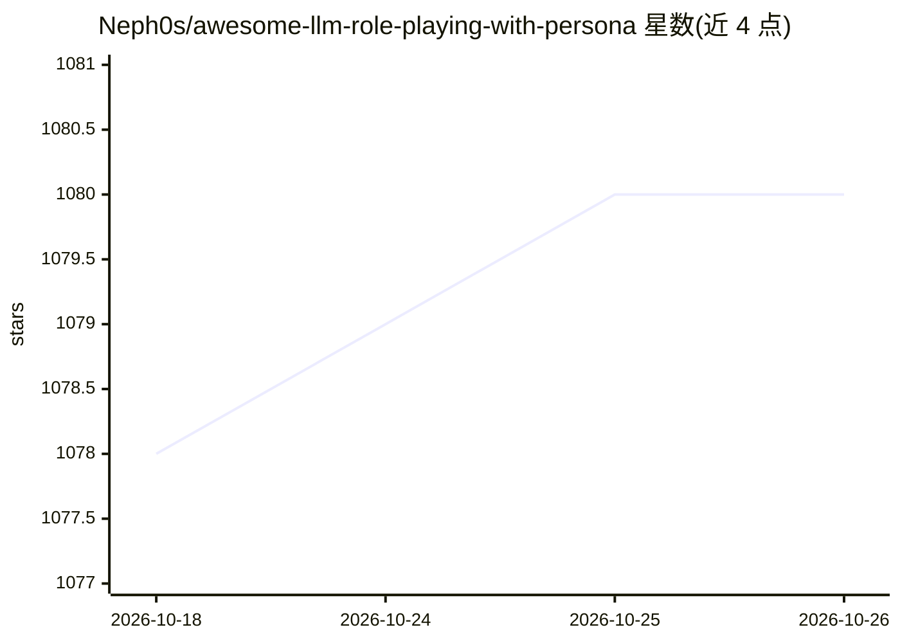

# Neph0s/awesome-llm-role-playing-with-persona

⭐ 1,080 · 推送 2026-06-19 · [GitHub](https://github.com/Neph0s/awesome-llm-role-playing-with-persona) · 组织维护 · 中文 README

**LLM 角色扮演（Persona）研究论文策展清单**

由复旦大学相关研究者维护的 Awesome 清单，聚焦大语言模型的角色扮演能力，涵盖虚构角色、名人与历史人物等 Character Role-Playing 方向。条目按角色扮演、既定角色等分类组织，收录综述、基准评测（如 RoleLLM、CharacterEval、CharacterBench）、数据集（如 PIPPA）与训练方法（如 CPO、ChARM）等论文，多为 2023-2026 年发表。仓库自述不保证覆盖多智能体系统与长上下文等相邻主题。配套综述论文被 TMLR 接收。

## 筛选速览

| 维度 | 判定 | 备注 |
|---|---|---|
| AI 角色 | `ai-knowledge` | 知识聚合/清单类 |
| 许可风险 | `permissive` | — |
| 部署形态 | `None` |  |
| 模型依赖 | — | README 未给出锁定关系 |
| 硬件要求 | — | 无带数字的原话,不猜 |
| 安装摩擦 | `low` | 无编译、无系统依赖或容器化 |
| 成熟度 | — | 结构信号不足 |

## 能力要点

- 按角色扮演/既定角色等类别组织的论文清单
- 配套综述 From Persona to Personalization 被 TMLR 接收
- 收录基准评测、数据集与训练方法等多类工作
- 2023-2026 年间持续更新（News 记录多次重组与增补）

## 适用场景

- 查找 LLM 角色扮演方向的论文与基准
- 跟踪角色扮演 Agent 的评测与训练方法进展
- 为角色扮演研究寻找可用数据集

## 场景标签

`精选清单` · 领域:学习与行业

## 证据(README 行号)

> L7: This repo primarily focuses on **character role-playing**, such as fictional characters, celebrities, and historical
> L15: - **2024-10-09 🎉 Our survey paper"*From Persona to Personalization:A Survey on Role-Playing Language Agents"* [arxi
> L21: - **2024-04-17 We are looking for collaborators interested in research on this topic. Contact us via email: xtwang2

## 星数曲线

2026-10-18 1,078 → 2026-10-26 1,080（+2）

---
*卡片 v1 · prompt 1.4 · 生成 2026-10-21 · 置信度 high · 依据 README sha `793c1df5afe7` · [字段定义](../../DATASET.md)*
