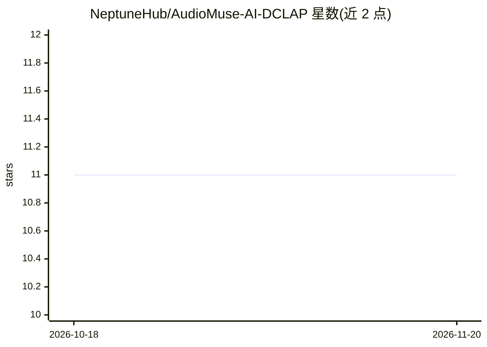

# NeptuneHub/AudioMuse-AI-DCLAP

⭐ 11 · Python · AGPL-3.0 · 推送 2026-06-17 · [GitHub](https://github.com/NeptuneHub/AudioMuse-AI-DCLAP) · 个人维护

**7M 参数蒸馏版 CLAP，轻量快速的文本搜音乐模型**

将 LAION CLAP 的音频塔从约 80M 参数蒸馏至 7M 参数，保留 512 维嵌入空间；文本塔直接复用 LAION CLAP 导出的 .onnx。训练采用双学生蒸馏加门控融合机制，运行速度提升 5-6 倍，可在 Raspberry PI 5 8GB 上运行。输出文本与音频的 512 维 L2 归一化嵌入，通过点积做相似度检索；歌曲需切分为 10 秒片段（50% 重叠）分别推理后取平均。模型与权重从项目 release 下载，以 Python 依赖方式运行于 CPU。

## 筛选速览

| 维度 | 判定 | 备注 |
|---|---|---|
| AI 角色 | `ai-native` | 本体是模型或模型工具 |
| 许可风险 | `viral` | AGPL-3.0 |
| 部署形态 | `library` | 以包/库形式分发 |
| 模型依赖 | — | README 未给出锁定关系 |
| 硬件要求 | — | 无带数字的原话,不猜 |
| 安装摩擦 | `low` | 无编译、无系统依赖或容器化 |
| 成熟度 | — | 结构信号不足 |

## 能力要点

- 音频塔蒸馏至 7M 参数，保留 512 维嵌入空间
- 运行速度提升 5-6 倍，可在 Raspberry PI 5 8GB 运行
- 双学生蒸馏加门控融合，训练代码在 student_clap 目录
- 基于 onnxruntime 推理，文本编码器复用 LAION CLAP .onnx

## 适用场景

- 在树莓派等边缘设备上做文本到音乐的搜索
- 对歌曲音频生成嵌入并与文本嵌入做相似度匹配
- 基于蒸馏方法研究小型音频模型训练

## 场景标签

`多模态` `模型训练` `语义搜索` · 领域:知识与检索

## 证据(README 行号)

> L3: AudioMuse-AI Distilled CLAP (DCLAP) distill the LAION CLAP audio tower into a tiny 7 M‑parameter model while retaini
> L9: The goal is simple: distill LAION CLAP's behaviour while cutting the audio tower from ~80 M params to ~7 M and **run

## 星数曲线

2026-10-18 11 → 2026-11-20 11（+0）

---
*卡片 v1 · prompt 1.4 · 生成 2026-11-19 · 置信度 high · 依据 README sha `2ac558f6e4f2` · [字段定义](../../DATASET.md)*
