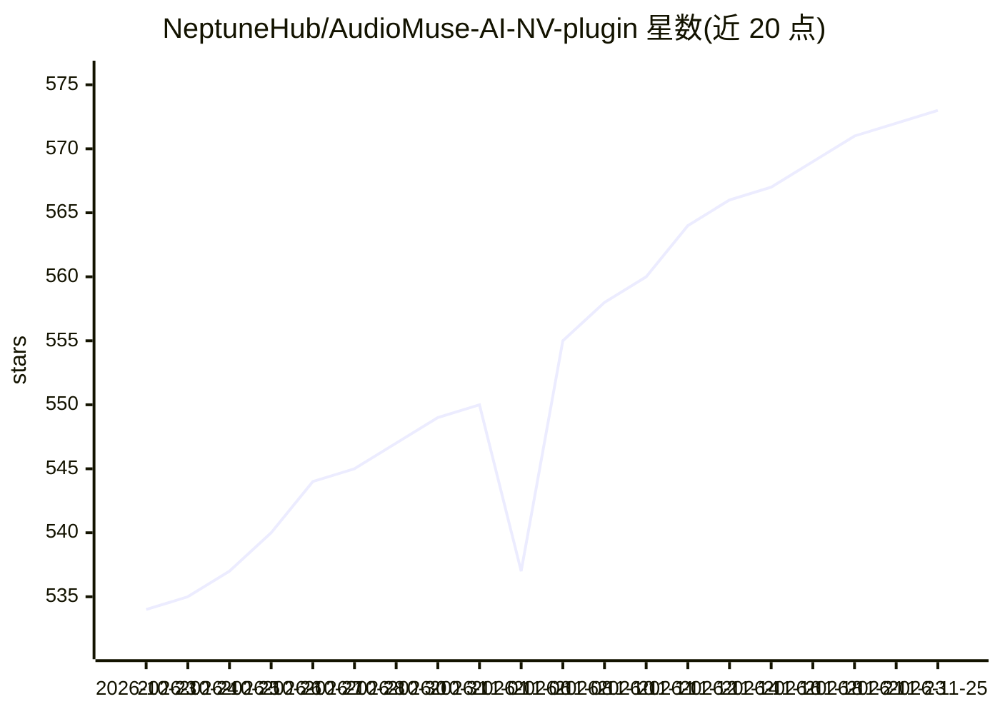

# NeptuneHub/AudioMuse-AI-NV-plugin

⭐ 573 · Go · AGPL-3.0 · 推送 2026-11-11 · [GitHub](https://github.com/NeptuneHub/AudioMuse-AI-NV-plugin) · 组织维护

**Navidrome 插件：将 AudioMuse-AI 声波相似度接入前端即时混音**

该仓库是 Navidrome 的插件（audiomuseai.ndp），把 AudioMuse-AI 核心服务的声学分析能力接入 Navidrome 前端，提供 Instant Mix 歌曲相似、Radio 艺人相似与相似艺人信息三类功能，通过 getSimilarSongs2/getSimilarSongs 与 getArtistInfo API 供客户端调用。安装需部署 Navidrome 相关 ENV 变量并将插件文件放入 plugins 目录，依赖单独运行的 AudioMuse-AI 核心容器；自编译需 Go 与 TinyGo。已列明测试过的多个 Web 与移动前端。

## 筛选速览

| 维度 | 判定 | 备注 |
|---|---|---|
| AI 角色 | `ai-native` | 本体是模型或模型工具 |
| 许可风险 | `viral` | AGPL-3.0 |
| 部署形态 | `self-host` | docker 或自建部署 |
| 模型依赖 | — | README 未给出锁定关系 |
| 硬件要求 | — | 无带数字的原话,不猜 |
| 安装摩擦 | `low` | 无编译、无系统依赖或容器化 |
| 成熟度 | — | 结构信号不足 |

## 能力要点

- 提供 Instant Mix 歌曲相似与 Radio 艺人相似功能
- 支持多种相似引擎选择：Similar Song、Lyrics by Song、Hyperbolic、DCLAP、Song Alchemy
- 兼容多个第三方前端客户端（Substreamer、Tempus、Symfonium、Feishin、Wavio）
- 提供 make build/package 编译流程，输出 .wasm 与 .ndp

## 适用场景

- 在 Navidrome 前端对某首歌一键生成即时混音队列
- 让移动客户端通过 Subsonic API 获取相似歌曲与相似艺人
- 为多前端环境统一接入 AudioMuse-AI 的相似度服务

## 场景标签

`推荐系统` · 领域:学习与行业

## 证据(README 行号)

> L10: **AudioMuse-AI-NV-Plugin** the a Navidrome plugin that integrates core AudioMuse-AI features into the Navidrome fro
> L13: - Instant Mix - Song similarity
> L63: - Restart Navidrome, go to UI -> Plugins, enable **AudioMuse-AI**, set **AudioMuse-AI API URL** and other configura

## 星数曲线

2026-10-23 534 → 2026-11-25 573（+39）

---
*卡片 v1 · prompt 1.4 · 生成 2026-11-25 · 置信度 mid · 依据 README sha `6934587fa53a` · [字段定义](../../DATASET.md)*
