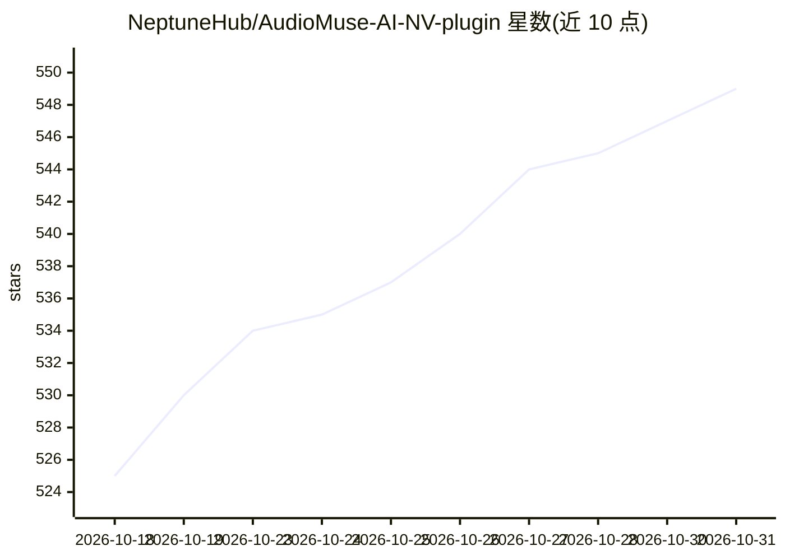

# NeptuneHub/AudioMuse-AI-NV-plugin

⭐ 549 · Go · AGPL-3.0 · 推送 2026-10-29 · [GitHub](https://github.com/NeptuneHub/AudioMuse-AI-NV-plugin) · 组织维护

**将 AudioMuse-AI 相似歌曲分析接入 Navidrome 的插件**

Navidrome 音乐服务器插件：把 AudioMuse-AI 核心容器提供的声音分析能力映射到 Navidrome 前端，实现 Instant Mix（歌曲相似）、Radio（艺人相似）与 Artist Info 三类功能，兼容 Substreamer、Tempus、Symfonium、Feishin、Wavio 等第三方客户端。插件为 .ndp 包，放入 Navidrome 数据插件目录并配置 API URL 即可使用；Instant Mix 引擎可在 Similar Song、Lyrics by Song（SemGrove）、Hyperbolic Similarity 三种间切换，后两种依赖 AudioMuse-AI 中预建的索引。可用 Go/TinyGo 从源码构建。

## 筛选速览

| 维度 | 判定 | 备注 |
|---|---|---|
| AI 角色 | `ai-ecosystem` | LLM/agent 周边工具 |
| 许可风险 | `viral` | AGPL-3.0 |
| 部署形态 | `self-host` | docker 或自建部署 |
| 模型依赖 | — | README 未给出锁定关系 |
| 硬件要求 | — | 无带数字的原话,不猜 |
| 安装摩擦 | `low` | 无编译、无系统依赖或容器化 |
| 成熟度 | — | 结构信号不足 |

## 能力要点

- 在 Navidrome 前端提供 Instant Mix / Radio / Artist Info 三类功能
- Instant Mix 支持三种引擎：Similar Song、Lyrics by Song（SemGrove）、Hyperbolic Similarity
- 兼容 Substreamer、Tempus、Symfonium、Feishin、Wavio 等多个前端客户端
- 提供 API Token 与多音乐服务器（Server Name）配置

## 适用场景

- 在 Navidrome 网页端对任意曲目生成相似歌曲即时混播
- 通过 Subsonic 兼容移动客户端使用相似歌曲/电台功能
- 在自建音乐库中按歌词语义或双曲投影查找相似曲目

## 场景标签

`推荐系统` `语义搜索` · 领域:知识与检索

## 证据(README 行号)

> L10: **AudioMuse-AI-NV-Plugin** the a Navidrome plugin that integrates core AudioMuse-AI features into the Navidrome fro
> L35:  > * AudioMuse-AI: the core application, it run Flask and Worker containers to actually run all the feature;

## 星数曲线

2026-10-18 525 → 2026-10-31 549（+24）

---
*卡片 v1 · prompt 1.4 · 生成 2026-10-22 · 置信度 mid · 依据 README sha `efd74a1966c8` · [字段定义](../../DATASET.md)*
