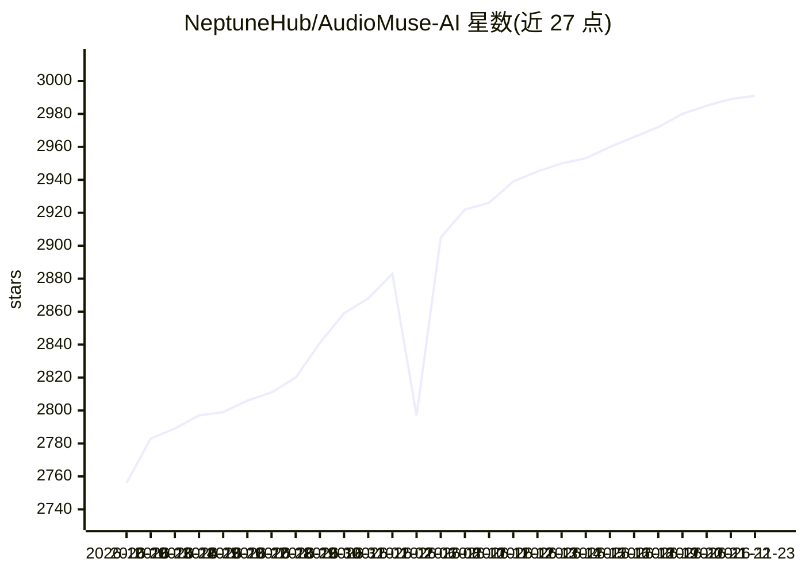

# NeptuneHub/AudioMuse-AI

⭐ 2,991 · Python · AGPL-3.0 · 推送 2026-11-22 · [GitHub](https://github.com/NeptuneHub/AudioMuse-AI) · [官网](https://neptunehub.github.io/AudioMuse-AI/) · 个人维护

**自托管音乐库的声学分析与智能歌单生成工具**

AudioMuse-AI 是一个自托管工具，通过声学分析（sonic analysis）扫描本地音乐库，支持聚类、即时歌单、音乐地图、声学指纹、歌曲路径、文本/歌词/录音搜索等功能，并将结果导出到 Navidrome、Jellyfin、LMS、Lyrion、Emby、Plex 等媒体服务器。部署方式包括 Docker Compose/Podman、Kubernetes（Helm Chart）以及 macOS/Windows/Linux 原生安装包，支持 AMD64 与 ARM64。歌词搜索仅支持 72 种列出的语言，要求 PostgreSQL v15。

## 筛选速览

| 维度 | 判定 | 备注 |
|---|---|---|
| AI 角色 | `ai-native` | 本体是模型或模型工具 |
| 许可风险 | `viral` | AGPL-3.0 |
| 部署形态 | `desktop` | 安装包/桌面程序 |
| 模型依赖 | — | README 未给出锁定关系 |
| 硬件要求 | — | 无带数字的原话,不猜 |
| 安装摩擦 | `low` | 无编译、无系统依赖或容器化 |
| 成熟度 | — | 结构信号不足 |

## 能力要点

- 连接多个媒体服务器到单一部署，内置重复检测每首歌只分析一次
- 支持 Docker Compose/Podman、Kubernetes Helm Chart 与三平台原生安装包
- 文本、歌词、20 秒录音三种检索方式
- 提供 Web UI、Swagger API 文档与浏览器 Setup Wizard 配置

## 适用场景

- 为 Navidrome/Jellyfin 音乐库自动生成声学相似歌单
- 用一句话描述风格让 AI 即时生成播放列表
- 在本地服务器上离线分析音乐库而不依赖元数据或外部服务
- 用 20 秒录音片段查找库中对应歌曲

## 场景标签

 · 领域:音乐/自托管媒体工具

## 证据(README 行号)

> L29: AudioMuse-AI is an opensource and self-hosted tool that uses sonic analysis to rediscover forgotten songs in your m
> L38: * **Instant Playlists**: Simply tell the AI what you want to hear-like "high-tempo, low-energy music" and it will i
> L31: You can run it locally with Docker Compose or Podman, deploy it at scale in a Kubernetes cluster (**AMD64** and **A

## 星数曲线

2026-10-20 2,756 → 2026-11-23 2,991（+235）

---
*卡片 v1 · prompt 1.4 · 生成 2026-11-23 · 置信度 high · 依据 README sha `fccb09ef9b0f` · [字段定义](../../DATASET.md)*
