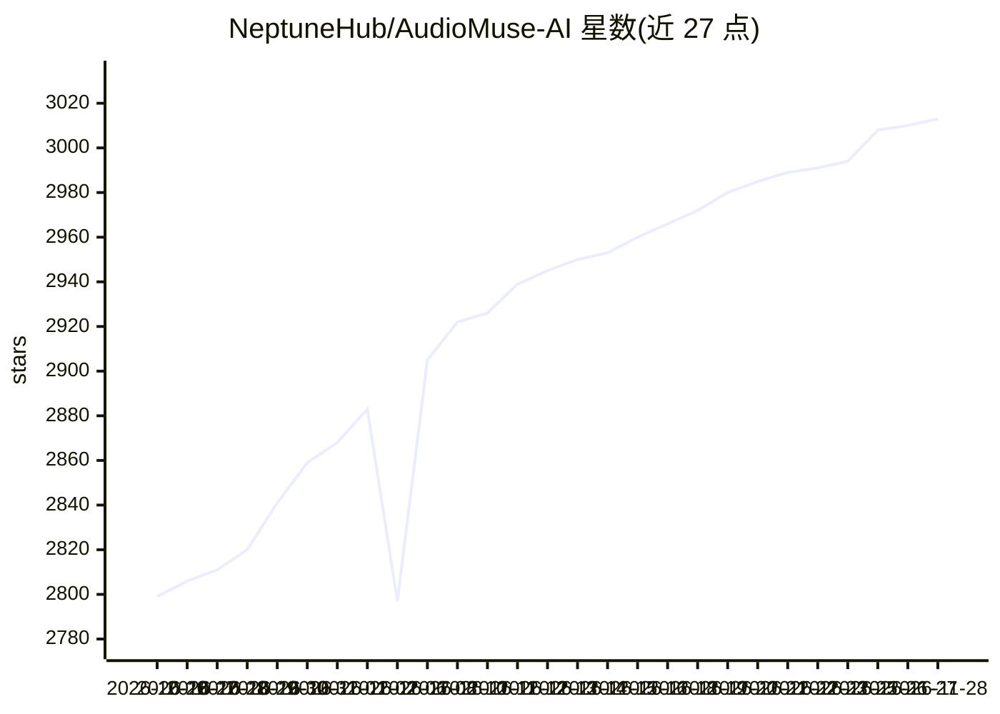

# NeptuneHub/AudioMuse-AI

⭐ 3,013 · Python · AGPL-3.0 · 推送 2026-11-27 · [GitHub](https://github.com/NeptuneHub/AudioMuse-AI) · [官网](https://neptunehub.github.io/AudioMuse-AI/) · 个人维护

**自托管音乐库声学分析工具：为媒体服务器生成智能播放列表**

开源自托管工具，通过声学分析（sonic analysis）在不依赖元数据或外部 API 的情况下分析本地音乐库，提供聚类、即时播放列表、音乐地图、声纹、录音搜索、歌词/文本搜索等功能，并将结果导出到 Navidrome、Jellyfin、LMS、Lyrion、Emby、Plex 等媒体服务器。部署方式包括 Docker Compose、Podman、Kubernetes（Helm Chart）及 macOS/Windows/Linux 原生安装包。最低硬件要求 4 核支持 AVX2 的 CPU、8 GB 内存与 NVMe SSD。歌词搜索支持 72 种语言。

## 筛选速览

| 维度 | 判定 | 备注 |
|---|---|---|
| AI 角色 | `ai-native` | 本体是模型或模型工具 |
| 许可风险 | `viral` | AGPL-3.0 |
| 部署形态 | `desktop` | 安装包/桌面程序 |
| 模型依赖 | — | README 未给出锁定关系 |
| 硬件要求 | — | 无带数字的原话,不猜 |
| 安装摩擦 | `low` | 无编译、无系统依赖或容器化 |
| 成熟度 | — | 结构信号不足 |

## 能力要点

- 对多台媒体服务器单部署接入并自动去重分析
- 20 秒录音搜索库内歌曲、按主题/含义检索歌词
- 支持 Docker、Kubernetes Helm 及三大平台原生安装包
- 浏览器 Setup Wizard 配置并持久化到 PostgreSQL

## 适用场景

- 为自托管音乐服务器自动生成风格与节奏感知的播放列表
- 在本地视觉化探索音乐库的声学聚类关系
- 通过录音片段快速找出正在播放的歌曲

## 场景标签

 · 领域:音乐/媒体服务器工具

## 证据(README 行号)

> L29: AudioMuse-AI is an opensource and self-hosted tool that uses sonic analysis to rediscover forgotten songs in your m
> L38: * **Instant Playlists**: Simply tell the AI what you want to hear-like "high-tempo, low-energy music" and it will i
> L31: You can run it locally with Docker Compose or Podman, deploy it at scale in a Kubernetes cluster (**AMD64** and **A

## 星数曲线

2026-10-26 2,799 → 2026-11-28 3,013（+214）

---
*卡片 v1 · prompt 1.4 · 生成 2026-11-28 · 置信度 high · 依据 README sha `5ff3f7299c41` · [字段定义](../../DATASET.md)*
