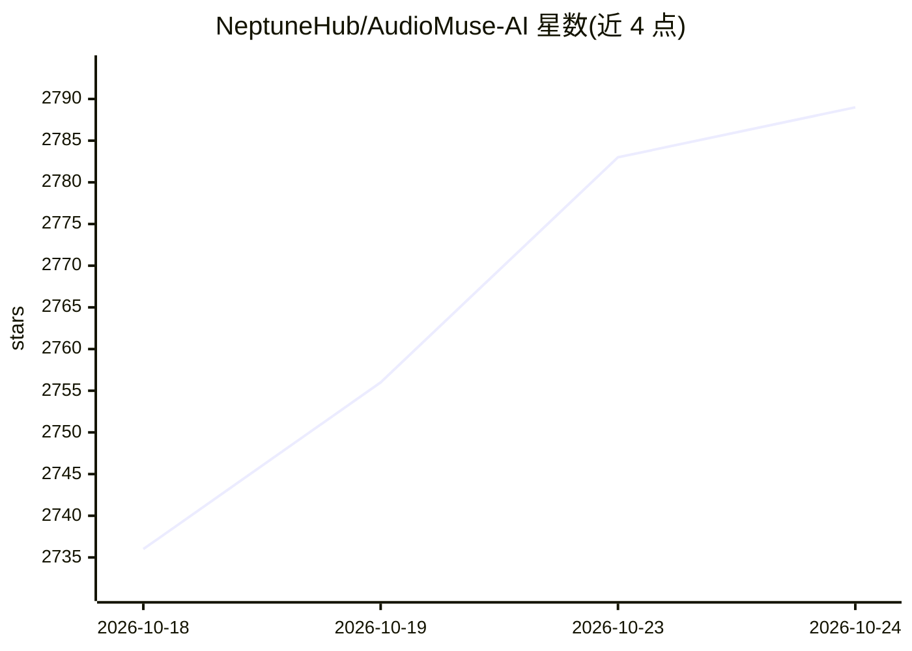

# NeptuneHub/AudioMuse-AI

⭐ 2,789 · Python · AGPL-3.0 · 推送 2026-10-23 · [GitHub](https://github.com/NeptuneHub/AudioMuse-AI) · [官网](https://neptunehub.github.io/AudioMuse-AI/) · 组织维护

**自托管音乐库声学分析与智能歌单生成工具**

面向自托管音乐服务器用户的开源应用：对音乐库做声学分析，自动聚类相似歌曲、按文字描述或歌词主题生成歌单、绘制音乐地图、查找相似曲目与衔接歌单，并可录制 20 秒片段识别库中歌曲。支持同时接入 Navidrome、Jellyfin、LMS、Lyrion、Emby、Plex 多个媒体服务器并跨服务器去重。提供 Docker Compose 部署与 macOS/Linux/Windows 原生安装包（内嵌 PostgreSQL），Kubernetes 下有 Helm Chart（AMD64/ARM64）。歌词搜索限 72 种语言；需 CPU 支持 AVX2 或 ARM。

## 筛选速览

| 维度 | 判定 | 备注 |
|---|---|---|
| AI 角色 | `ai-native` | 本体是模型或模型工具 |
| 许可风险 | `viral` | AGPL-3.0 |
| 部署形态 | `desktop` | 安装包/桌面程序 |
| 模型依赖 | — | README 未给出锁定关系 |
| 硬件要求 | — | 无带数字的原话,不猜 |
| 安装摩擦 | `low` | 无编译、无系统依赖或容器化 |
| 成熟度 | `idea` | |

## 能力要点

- 声学聚类与多种歌单生成（文字描述/歌词主题/相似歌曲/Song Paths）
- 多音乐服务器接入与跨服务器重复检测，每曲只分析一次
- 录制 20 秒片段即可识别库中对应歌曲
- Docker Compose、Kubernetes（Helm）及三平台原生安装包（内嵌 PostgreSQL）

## 适用场景

- 在我的 Navidrome/Jellyfin/Plex 音乐库上自动发现相似歌曲并生成歌单
- 用一句话描述想要的歌单直接生成
- 通过歌词主题或录制环境片段搜索自己的曲库

## 场景标签

`推荐系统` · 领域:学习与行业

## 证据(README 行号)

> L13: AudioMuse-AI is an opensource and self-hosted tool that uses sonic analysis to rediscover forgotten songs in your m
> L22: * **Instant Playlists**: Simply tell the AI what you want to hear-like "high-tempo, low-energy music" and it will i
> L30: * **Search by Recording**: record 20 seconds of whatever is playing around you, or upload a clip, and find which so

## 星数曲线

2026-10-18 2,736 → 2026-10-24 2,789（+53）

---
*卡片 v1 · prompt 1.4 · 生成 2026-10-21 · 置信度 high · 依据 README sha `804794da55cf` · [字段定义](../../DATASET.md)*
