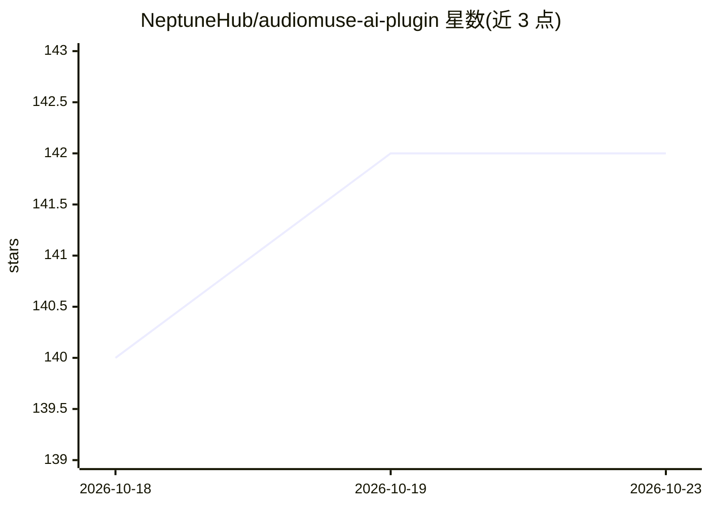

# NeptuneHub/audiomuse-ai-plugin

⭐ 142 · C# · AGPL-3.0 · 推送 2026-09-01 · [GitHub](https://github.com/NeptuneHub/audiomuse-ai-plugin) · 个人维护

**Jellyfin 插件：把 AudioMuse-AI 音乐分析功能接入媒体服务器**

面向 Jellyfin 12.0 的插件，将 AudioMuse-AI 核心服务的功能集成到 Jellyfin 前端，并提供与 AudioMuse-AI 后端 1:1 映射的 API 端点，前端应用可直接调用 Jellyfin 接口而无需代理。终端用户可获得三类定时任务（每日分析、每周聚类与声纹指纹），以及相似曲目、路径生成、Instant Mix、对话式歌单等音乐发现功能。插件自身依赖已部署的 AudioMuse-AI 容器服务，通过插件目录 manifest 安装，自编译需 dotnet-sdk-8.0。已测试兼容 Jellyfin 官方前端及 Finamp、Jellify、Symfonium、Feishin、Wavio 等客户端。

## 筛选速览

| 维度 | 判定 | 备注 |
|---|---|---|
| AI 角色 | `ai-ecosystem` | LLM/agent 周边工具 |
| 许可风险 | `viral` | AGPL-3.0 |
| 部署形态 | `library` | 以包/库形式分发 |
| 模型依赖 | — | README 未给出锁定关系 |
| 硬件要求 | — | 无带数字的原话,不猜 |
| 安装摩擦 | `medium` | 含编译或系统依赖之一 |
| 成熟度 | — | 结构信号不足 |

## 能力要点

- 提供与 AudioMuse-AI 后端 1:1 映射的 Jellyfin API 端点
- 集成分析、聚类、声纹指纹三类定时任务
- 支持相似曲目搜索、歌曲路径生成（find_path）与 Instant Mix
- 对话式歌单（chat/playlist）返回 AI 回复与曲目列表

## 适用场景

- 在 Jellyfin 中一键生成相似歌曲即时混播歌单
- 定时对音乐库做声学分析与聚类
- 前端开发者直接通过 Jellyfin 端点接入 AudioMuse-AI 功能

## 场景标签

`推荐系统` · 领域:学习与行业

## 证据(README 行号)

> L10: **AudioMuse-AI-Plugin** is a Jellyfin plugin that integrates core AudioMuse-AI features into the Jellyfin front-end
> L31:  > * AudioMuse-AI: the core application, it run Flask and Worker containers to actually run all the feature;
> L292: Used in the **Instant Playlist** feature to chat with the AI. You send a user query, and it returns both the AI’s 

## 星数曲线

2026-10-18 140 → 2026-10-23 142（+2）

---
*卡片 v1 · prompt 1.4 · 生成 2026-10-22 · 置信度 high · 依据 README sha `819ced733da1` · [字段定义](../../DATASET.md)*
