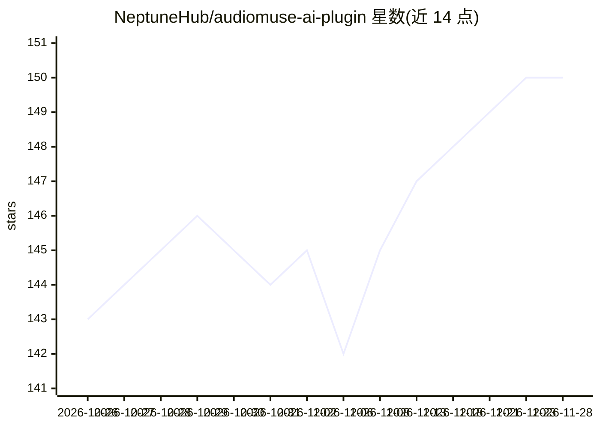

# NeptuneHub/audiomuse-ai-plugin

⭐ 150 · C# · AGPL-3.0 · 推送 2026-11-27 · [GitHub](https://github.com/NeptuneHub/audiomuse-ai-plugin) · 组织维护

**将 AudioMuse-AI 声音分析功能集成进 Jellyfin 前端的音乐插件**

Jellyfin 插件，把 AudioMuse-AI 核心应用的分析、聚类、声纹三个定时任务接入 Jellyfin 任务面板，并通过 1:1 API 映射暴露 Instant Mix、相似曲目、路径连播、播放单创建等端点。插件依赖已部署的 AudioMuse-AI 容器后端，安装时需配置后端地址，支持多服务器场景的 server 参数。经测试可配合 Jellyfin 官方 Web/移动端及 Finamp、Symfonium 等多个前端使用；自行修改源码需 dotnet-sdk-8.0 编译产出 DLL。

## 筛选速览

| 维度 | 判定 | 备注 |
|---|---|---|
| AI 角色 | `ai-enhanced` | 去掉 AI 部分产品仍成立 |
| 许可风险 | `viral` | AGPL-3.0 |
| 部署形态 | `library` | 以包/库形式分发 |
| 模型依赖 | — | README 未给出锁定关系 |
| 硬件要求 | — | 无带数字的原话,不猜 |
| 安装摩擦 | `medium` | 含编译或系统依赖之一 |
| 成熟度 | — | 结构信号不足 |

## 能力要点

- 向 Jellyfin 集成每日分析、每周聚类与声纹三个定时任务
- 1:1 API 映射：前端可直接调用 Jellyfin 端点，无需额外代理
- 提供相似曲目、路径连播（find_path）、Instant Mix、批量任务管理端点
- 测试兼容 Finamp、Jellify、Symfonium、Feishin、Wavio 等前端

## 适用场景

- 在 Jellyfin 中按艺术家/专辑/歌曲一键生成 Instant Mix
- 用 API 批量管理音乐的声学分析任务
- 为自己的音乐前端集成相似曲目与播放单生成功能

## 场景标签

 · 领域:媒体服务器/音乐发现

## 证据(README 行号)

> L10: **AudioMuse-AI-Plugin** is a Jellyfin plugin that integrates core AudioMuse-AI features into the Jellyfin front-end
> L28: > * After installation, the AudioMuse-AI-Plugin must be configured with the correct AudioMuse-AI endpoint. Make sur

## 星数曲线

2026-10-26 143 → 2026-11-28 150（+7）

---
*卡片 v1 · prompt 1.4 · 生成 2026-11-27 · 置信度 high · 依据 README sha `d789eb498375` · [字段定义](../../DATASET.md)*
