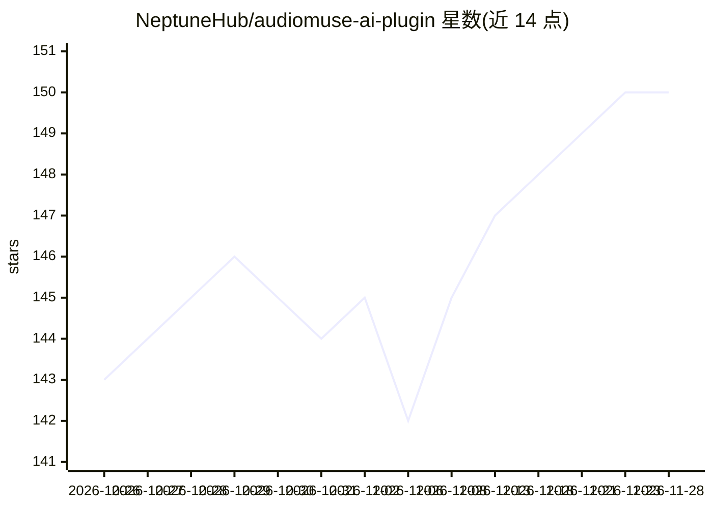

# NeptuneHub/audiomuse-ai-plugin

⭐ 150 · C# · AGPL-3.0 · 推送 2026-11-27 · [GitHub](https://github.com/NeptuneHub/audiomuse-ai-plugin) · 组织维护

**把 AudioMuse-AI 声波分析功能接入 Jellyfin 前端的服务器插件**

一个 Jellyfin 插件，将 AudioMuse-AI 核心应用的功能集成到 Jellyfin 界面：提供每日音频分析、每周聚类、声波指纹三个定时任务，并在 Jellyfin 端点上 1:1 映射 AudioMuse-AI API（相似曲目、InstantMix、路径查找、播放列表创建、批量任务管理），供前端开发者直接调用而无需额外代理。插件须配置指向已部署的 AudioMuse-AI 容器端点方可工作；通过 Jellyfin 插件目录 manifest 安装，本地修改需 dotnet-sdk-8.0 编译为 DLL。

## 筛选速览

| 维度 | 判定 | 备注 |
|---|---|---|
| AI 角色 | `ai-native` | 本体是模型或模型工具 |
| 许可风险 | `viral` | AGPL-3.0 |
| 部署形态 | `library` | 以包/库形式分发 |
| 模型依赖 | — | README 未给出锁定关系 |
| 硬件要求 | — | 无带数字的原话,不猜 |
| 安装摩擦 | `medium` | 含编译或系统依赖之一 |
| 成熟度 | — | 结构信号不足 |

## 能力要点

- 在 Jellyfin 内集成分析、聚类、声波指纹三个定时任务
- 1:1 API 映射，前端可直接调用 Jellyfin 端点
- 支持多媒体服务器配置（server 参数自动附加）
- 已测试 Jellyfin Web、Finamp、Symfonium 等多款前端

## 适用场景

- 在 Jellyfin 中基于声波相似度一键生成 Instant Mix
- 为自建音乐库安排定期音频分析与聚类
- 让第三方 Jellyfin 前端直接接入 AudioMuse-AI 功能

## 场景标签

 · 领域:多媒体/音乐发现

## 证据(README 行号)

> L10: **AudioMuse-AI-Plugin** is a Jellyfin plugin that integrates core AudioMuse-AI features into the Jellyfin front-end
> L28: > * After installation, the AudioMuse-AI-Plugin must be configured with the correct AudioMuse-AI endpoint. Make sur
> L54: - A running Jellyfin server

## 星数曲线

2026-10-26 143 → 2026-11-28 150（+7）

---
*卡片 v1 · prompt 1.4 · 生成 2026-11-28 · 置信度 high · 依据 README sha `b3803b9b9534` · [字段定义](../../DATASET.md)*
