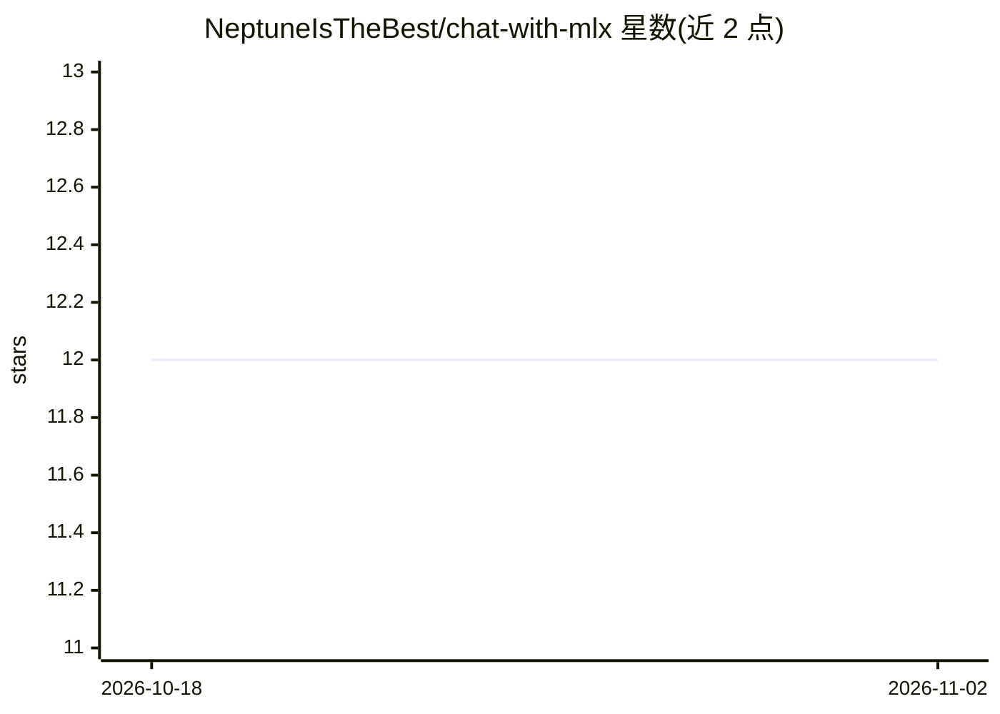

# NeptuneIsTheBest/chat-with-mlx

⭐ 12 · Python · MIT · 推送 2026-04-18 · [GitHub](https://github.com/NeptuneIsTheBest/chat-with-mlx) · 个人维护

**Apple Silicon 上的 MLX 本地 LLM 聊天 Web UI**

基于 MLX 框架、面向 Apple Silicon Mac 的本地 LLM 聊天 Web 界面，提供聊天、补全、模型管理、RAG、Function Call 等功能；支持上传 PDF/Word/Excel 等文件与图片（视觉模型），可查看推理模型的思维过程，另支持 OpenAI API 兼容的在线模型。模型从 HuggingFace 的 mlx-community 自动下载，通过 pip 从 GitHub 安装，运行命令启动 Gradio 页面（默认端口 7860）。项目自称处于活跃开发中。

## 筛选速览

| 维度 | 判定 | 备注 |
|---|---|---|
| AI 角色 | `ai-native` | 本体是模型或模型工具 |
| 许可风险 | `permissive` | MIT |
| 部署形态 | `library` | 以包/库形式分发 |
| 模型依赖 | — | README 未给出锁定关系 |
| 硬件要求 | — | 无带数字的原话,不猜 |
| 安装摩擦 | `low` | 无编译、无系统依赖或容器化 |
| 成熟度 | `idea` | |

## 能力要点

- 本地 MLX 推理，支持 Qwen3、Phi-4-reasoning、DeepSeek-R1 等模型
- 上传文件（PDF/Word/Excel/PPT 等）与图片对话
- 内置模型管理页，从 mlx-community 自动下载模型
- 支持 RAG、单 Function Call 与 OpenAI API 兼容在线模型

## 适用场景

- 在 Mac 上本地运行 LLM 并通过网页界面聊天
- 用视觉模型对上传图片进行对话
- 通过 RAG 与文件上传基于自有资料问答

## 场景标签

`聊天机器人` `文档问答` · 领域:对话与助手

## 证据(README 行号)

> L14: **Run LLM on your Mac!** An all-in-one LLMs chat Web UI based on the MLX framework, designed for Apple Silicon.
> L24: Also supports online LLM using OpenAI API compatible

## 星数曲线

2026-10-18 12 → 2026-11-02 12（+0）

---
*卡片 v1 · prompt 1.4 · 生成 2026-11-01 · 置信度 high · 依据 README sha `fddcfed05874` · [字段定义](../../DATASET.md)*
