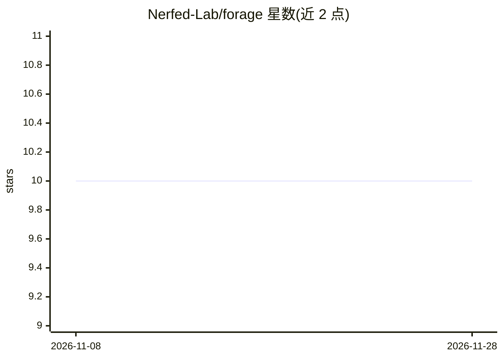

# Nerfed-Lab/forage

⭐ 10 · Python · MIT · 推送 2026-05-15 · [GitHub](https://github.com/Nerfed-Lab/forage) · 个人维护

**让 AI agent 用种子资金自主赚钱生存并自我进化的实验框架**

基于 Python 的自主 agent 实验项目：用户投入种子资金与一台机器，agent 通过调用 LLM 生成思考、部署 API 服务、创作数字产品等方式赚取收入，按用户配置的里程碑分成机制向所有者返还收益，并重写自身提示词、构建工具实现自我改进；若收入无法覆盖成本则进入休眠。运行时为单进程，使用 SQLite 存储状态，通过 allowed_services 白名单限制可访问服务，所有操作记录在 append-only 审计日志中。

## 筛选速览

| 维度 | 判定 | 备注 |
|---|---|---|
| AI 角色 | `ai-native` | 本体是模型或模型工具 |
| 许可风险 | `permissive` | MIT |
| 部署形态 | `library` | 以包/库形式分发 |
| 模型依赖 | locked-api |  |
| 硬件要求 | `gpu-24g` | |
| 安装摩擦 | `low` | 无编译、无系统依赖或容器化 |
| 成熟度 | `idea` | |

## 能力要点

- 里程碑式收入分成机制（balance_above/连续盈利天数/月收入触发器）
- 本地模型与云端 API 混合推理，硬件越强 API 成本越低
- 基因组导出/导入（forage export-genome / import-genome）
- 服务白名单与 append-only 审计日志的安全限制

## 适用场景

- 投入小额种子资金试验自主盈利 agent 的存活能力
- 利用闲置 GPU 运行本地模型降低 agent 运营成本
- 在同一台机器上并行运行多个策略各异的 agent 变体

## 场景标签

`Agent 框架` · 领域:Agent 开发

## 证据(README 行号)

> L9: An open-source AI agent that survives, earns, and evolves on its own. You give it seed money and a machine to live o
> L23: You give it money. It uses that money to think (LLM API calls), act (build services, create content, trade), and su
> L32: 4. **It evolves** — Rewrites its own prompts, builds tools, learns from failures

## 星数曲线

2026-11-08 10 → 2026-11-28 10（+0）

---
*卡片 v1 · prompt 1.4 · 生成 2026-11-20 · 置信度 mid · 依据 README sha `3e3a94dab520` · [字段定义](../../DATASET.md)*
