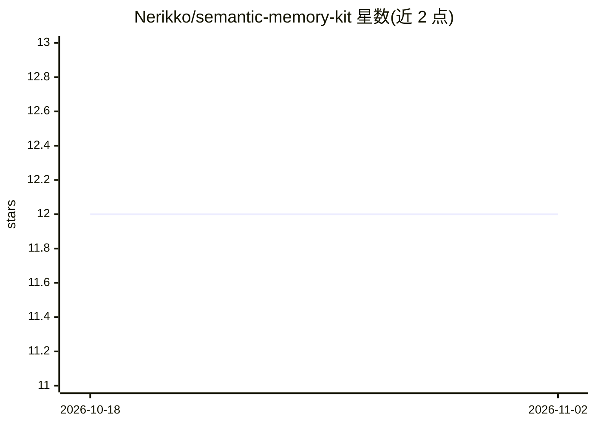

# Nerikko/semantic-memory-kit

⭐ 12 · Python · MIT · 推送 2026-04-06 · [GitHub](https://github.com/Nerikko/semantic-memory-kit) · [官网](https://sagnelli.gumroad.com/l/rplxp) · 个人维护

**给 AI agent 的本地语义记忆检索库：无向量库、纯 CPU**

面向 AI agent 开发者的轻量语义检索库：用 all-MiniLM-L6-v2（22MB）在本地对 .md/.txt/.json 记忆文件做嵌入，查询时按余弦相似度返回最相关片段，并可直接生成注入 prompt 的上下文；索引缓存到 JSON，文件未变则不重建。提供 Python 库与 CLI 两种使用方式。本仓库为免费核心版，另有 Gumroad 付费 Pro 包（含 Anthropic/OpenAI/Ollama 集成、去重脚本、模板等）。Benchmark 显示 2,000 块索引构建 13.2s，平均查询 42ms。

## 筛选速览

| 维度 | 判定 | 备注 |
|---|---|---|
| AI 角色 | `ai-ecosystem` | LLM/agent 周边工具 |
| 许可风险 | `permissive` | MIT |
| 部署形态 | `library` | 以包/库形式分发 |
| 模型依赖 | local-ok | 支持本地模型 |
| 硬件要求 | `cpu-ok` | |
| 安装摩擦 | `low` | 无编译、无系统依赖或容器化 |
| 成熟度 | — | 结构信号不足 |

## 能力要点

- 无向量数据库、无 API 调用，全部本地运行
- all-MiniLM-L6-v2 嵌入（22MB，CPU 可跑）+ 余弦相似度检索
- 支持 .md/.txt/.json，索引缓存且仅在文件变更时重建
- 同时提供 Python 库、CLI 与格式化 prompt 上下文输出

## 适用场景

- 给我的 agent 记忆文件做语义检索，避免整包塞进上下文
- 关键词搜不到意图时按含义找记忆片段
- 无服务器无 Docker 的单进程 agent 本地记忆方案

## 场景标签

`Agent 记忆` `语义搜索` · 领域:Agent 开发

## 证据(README 行号)

> L7: Lightweight semantic search over your AI agent's memory files. No vector database. No API calls. Runs on CPU.
> L21: - 3 ready-to-use integrations (Anthropic, OpenAI, Ollama)
> L91: import ollama

## 星数曲线

2026-10-18 12 → 2026-11-02 12（+0）

---
*卡片 v1 · prompt 1.4 · 生成 2026-11-01 · 置信度 mid · 依据 README sha `eb57a7a208e6` · [字段定义](../../DATASET.md)*
