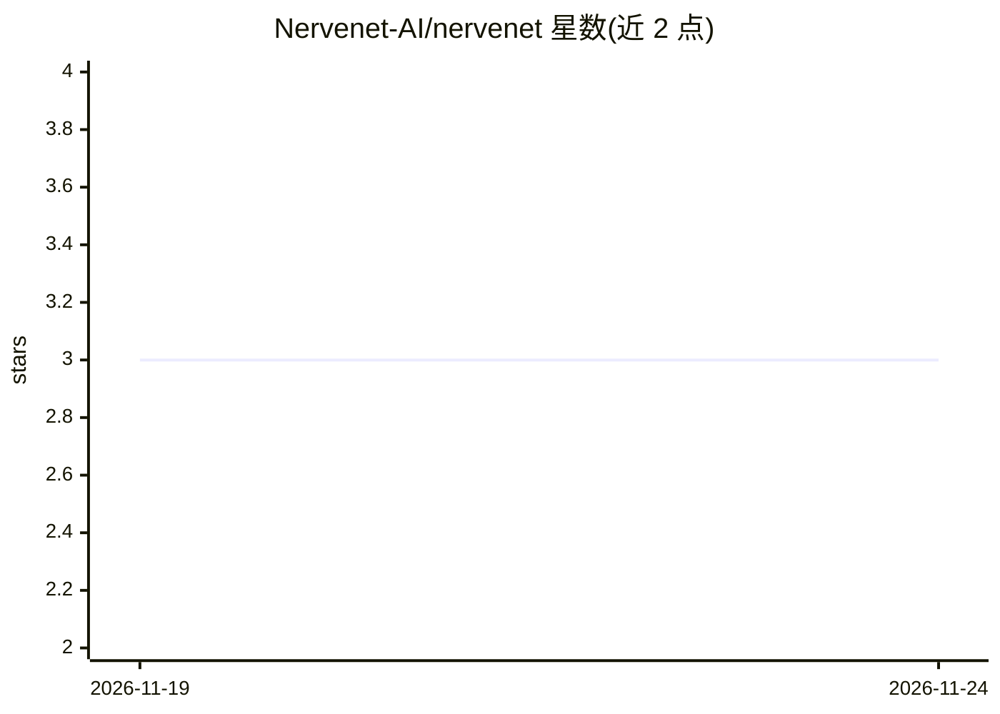

# Nervenet-AI/nervenet

⭐ 3 · 推送 2026-11-23 · [GitHub](https://github.com/Nervenet-AI/nervenet) · [官网](https://www.nervenet.app) · 组织维护

**桌面 AI agent：编排模型完成代码与研究任务**

面向个人电脑的桌面 AI agent 应用：在工作文件夹内读取文件、编辑代码、运行命令并检索网页，将大任务拆分给 subagents 并汇总报告；高风险步骤需经聊天内或 WhatsApp/Telegram 远程审批。支持 OpenAI、Anthropic、Ollama/LM Studio 及 OpenAI 兼容 API，用户自带 API key；提供定时任务、连接器/技能/记忆与可选的 Token 压缩功能。提供 Windows 安装包、macOS dmg 与 Linux tar.gz。

## 筛选速览

| 维度 | 判定 | 备注 |
|---|---|---|
| AI 角色 | `ai-native` | 本体是模型或模型工具 |
| 许可风险 | `none` | — |
| 部署形态 | `desktop` | 安装包/桌面程序 |
| 模型依赖 | local-ok | 支持本地模型 |
| 硬件要求 | — | 无带数字的原话,不猜 |
| 安装摩擦 | `low` | 无编译、无系统依赖或容器化 |
| 成熟度 | — | 结构信号不足 |

## 能力要点

- 多模型接入：OpenAI/Anthropic/本地 Ollama/LM Studio 及 OpenAI 兼容 API
- subagents 拆解任务、跟踪执行并回传报告
- 受限模式与审批机制：风险步骤需确认，可从手机审批
- WhatsApp/Telegram 消息通道与定时聊天

## 适用场景

- 让 agent 在本地项目文件夹里写代码、改文件
- 通过 WhatsApp/Telegram 远程指挥和审批 agent 任务
- 用本地 Ollama/LM Studio 模型在桌面跑自动化工作

## 场景标签

`AI 助手` `编码 Agent` `多智能体` · 领域:Agent 开发

## 证据(README 行号)

> L5: ### Put an AI agent to work on your computer.
> L24: |**Any model**|OpenAI, Anthropic, local servers such as Ollama or LM Studio, and other OpenAI-compatible APIs. Choo

## 星数曲线

2026-11-19 3 → 2026-11-24 3（+0）

---
*卡片 v1 · prompt 1.4 · 生成 2026-11-22 · 置信度 high · 依据 README sha `daeb11fd33ee` · [字段定义](../../DATASET.md)*
