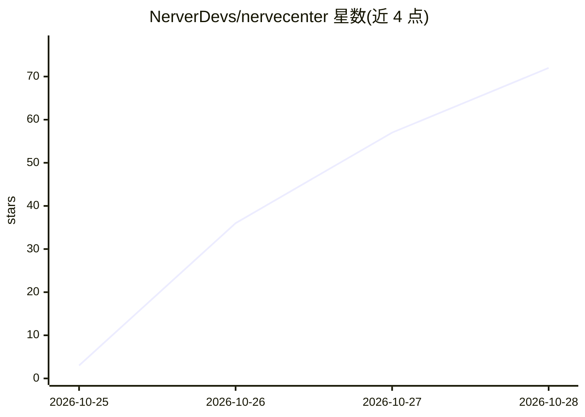

# NerverDevs/nervecenter

⭐ 92 · TypeScript · NOASSERTION · 推送 2026-10-24 · [GitHub](https://github.com/NerverDevs/nervecenter) · [官网](https://nvcenter.cc) · 组织维护 · 中文 README

**new-api/sub2api 中转站账号的闭源托管管理控制台**

面向中转站站长和多站点用户的 Web 服务：将各 new-api / sub2api 面板账号作为“渠道”接入，定时同步余额、上游 API Key、用量日志与分组倍率，提供模型比价、倍率变更时间线、余额预警与 Telegram/Webhook 推送，支持工作区、角色权限与个人 API 令牌。登录由用户本人通过 F12 复制凭据、浏览器扩展或云浏览器完成；上游凭据以 AES-256-GCM 加密存储。注意：本仓库仅为产品介绍与少量前端代码，服务本身闭源，代码无法构建运行、未授予开源许可。

## 筛选速览

| 维度 | 判定 | 备注 |
|---|---|---|
| AI 角色 | `ai-ecosystem` | LLM/agent 周边工具 |
| 许可风险 | `none` | NOASSERTION |
| 部署形态 | `None` |  |
| 模型依赖 | — | README 未给出锁定关系 |
| 硬件要求 | — | 无带数字的原话,不猜 |
| 安装摩擦 | `low` | 无编译、无系统依赖或容器化 |
| 成熟度 | — | 结构信号不足 |

## 能力要点

- 多站点余额、Key、用量与分组倍率集中同步（渠道制接入）
- 模型比价与倍率/模型变更时间线（默认 10/30 分钟比对）
- 余额预警等通知推送至站内、Telegram 与 HMAC-SHA256 签名 Webhook
- 凭据 AES-256-GCM 加密、全程审计与个人 API 令牌

## 适用场景

- 我有多个中转站账号，想在一处查余额、比价格
- 站长集中管理上游 Key 与用量，及时收到余额不足提醒
- 追踪各站点倍率与模型上下架变化

## 场景标签

`LLM 可观测性` · 领域:评测与运维

## 证据(README 行号)

> L3:  new-api / sub2api 中转站账号管理中心：多站点的余额、API Key、用量、分组倍率和提醒，放在一个控制台里。
> L22: - **中转站站长**：手上有一串上游账号，每个面板都要单独登录。查余额要一个个点开，Key 散在各处，倍率调了不知道，余额见底往往是用户报错才发现。
> L151: NerveCenter brings your accounts on many **new-api** and **sub2api** relay panels (中转站) into one console: balances

## 星数曲线

2026-10-25 3 → 2026-10-28 72（+69）

---
*卡片 v1 · prompt 1.4 · 生成 2026-10-25 · 置信度 high · 依据 README sha `9da51fe89e94` · [字段定义](../../DATASET.md)*
