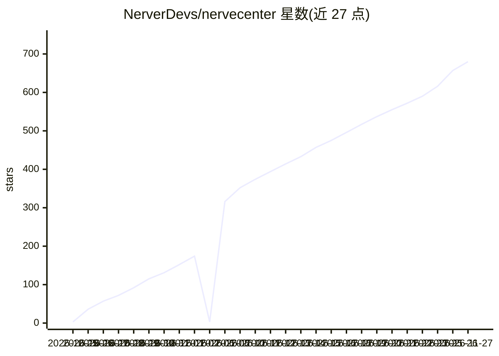

# NerverDevs/nervecenter

⭐ 680 · Go · MIT · 推送 2026-11-26 · [GitHub](https://github.com/NerverDevs/nervecenter) · [官网](https://nvcenter.cc) · 组织维护 · 中文 README

**面向 CLI 用户的多厂商模型代理服务器与账号接入管理**

CLIProxyAPI 是一个代理服务器，为本地与多账号场景提供 OpenAI/Gemini/Claude/Grok 兼容的 API 接口，供任意兼容客户端或 SDK 访问 Kimi、OpenAI、Anthropic、Gemini、xAI、Meta、Devin 等厂商模型。支持 OAuth 登录接入 Codex/Claude Code/Grok Build，多账号轮询负载均衡，流式/非流式/WebSocket 响应，函数调用与多模态输入；内置用量统计自 v6.10.0 起移除，改由第三方面板承担。提供 Go SDK 供嵌入，另有 EasyCLIProxyAPI 桌面客户端提供图形化配置。

## 筛选速览

| 维度 | 判定 | 备注 |
|---|---|---|
| AI 角色 | `ai-ecosystem` | LLM/agent 周边工具 |
| 许可风险 | `permissive` | MIT |
| 部署形态 | `None` |  |
| 模型依赖 | locked-api |  |
| 硬件要求 | — | 无带数字的原话,不猜 |
| 安装摩擦 | `low` | 无编译、无系统依赖或容器化 |
| 成熟度 | — | 结构信号不足 |

## 能力要点

- 提供 OpenAI/Gemini/Claude/Grok 兼容 API 端点
- OAuth 登录接入 Codex、Claude Code、Grok Build
- 多账号轮询负载均衡与 CLI 认证流程
- 可复用 Go SDK 供嵌入代理功能

## 适用场景

- 用已有订阅账号给本地 AI 编码工具提供模型接口
- 在多个厂商账号间做轮询与配额分摊
- 通过 SDK 把代理能力嵌入自己的应用

## 场景标签

`模型网关` · 领域:Agent 开发

## 证据(README 行号)

> L7: CLIProxyAPI is a proxy server that provides OpenAI/Gemini/Claude/Codex/Grok compatible API interfaces for CLI.
> L39: - OpenAI/Gemini/Claude/Grok compatible API endpoints for CLI models
> L46: - Multiple accounts with round-robin load balancing (Gemini, OpenAI, Claude, Grok)

## 星数曲线

2026-10-25 3 → 2026-11-27 680（+677）

---
*卡片 v1 · prompt 1.4 · 生成 2026-11-27 · 置信度 high · 依据 README sha `61fd5edd8897` · [字段定义](../../DATASET.md)*
