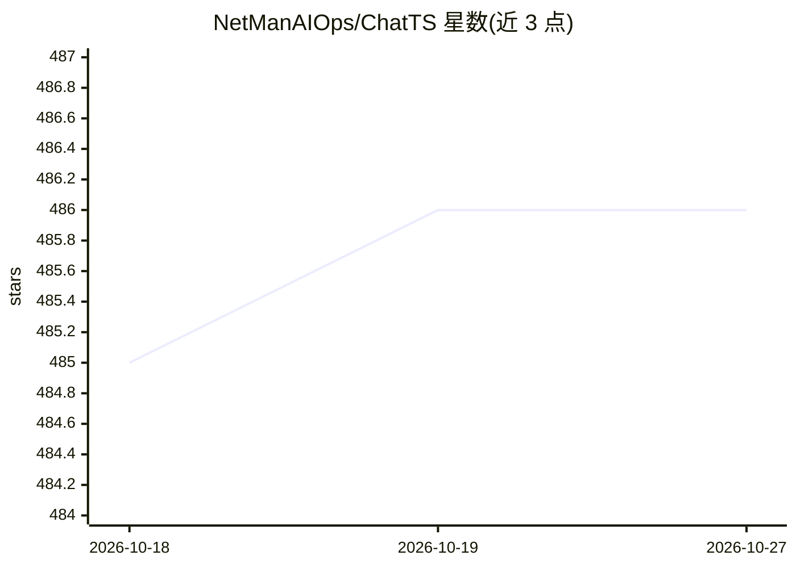

# NetManAIOps/ChatTS

⭐ 486 · Python · MIT · 推送 2026-07-09 · [GitHub](https://github.com/NetManAIOps/ChatTS) · [官网](https://huggingface.co/spaces/xiezhe22/ChatTS) · 组织维护 · 中文 README

**面向时间序列理解与推理问答的多模态 LLM（8B/14B）**

ChatTS 是 VLDB'25 论文的官方实现：一个以多元时间序列为原生模态的多模态 LLM（TS-MLLM），输入时间序列与文本提问，通过时间序列编码器将定长 patch 与文本 token 拼接后交由 LLM 生成回答，支持保留原始数值的问答与多变量不同长度序列。提供 8B/14B 权重（含 GPTQ-Int4 量化版）、Hugging Face Spaces 在线 Demo、Transformers/vLLM 部署路径及 OpenAI API 兼容服务；另含训练数据生成脚本（TSEvol 等）与评测代码（基于 ragas）。推理需 Python 3.11 与支持 Flash-Attention 的 GPU（如 A100/A800）；推荐序列长度 64-1024，过短序列可靠性下降。训练基于修改版 LLaMA-Factory。

## 筛选速览

| 维度 | 判定 | 备注 |
|---|---|---|
| AI 角色 | `ai-native` | 本体是模型或模型工具 |
| 许可风险 | `permissive` | MIT |
| 部署形态 | `library` | 以包/库形式分发 |
| 模型依赖 | local-ok | 支持本地模型 |
| 硬件要求 | — | 无带数字的原话,不猜 |
| 安装摩擦 | `low` | 无编译、无系统依赖或容器化 |
| 成熟度 | — | 结构信号不足 |

## 能力要点

- 原生时间序列模态：patch 编码后与文本 token 拼接进 LLM
- 保留原始数值，可回答关于具体数值（如峰值大小）的问题
- 单 prompt 支持不同长度、灵活维度的多变量时间序列
- 提供 vLLM 部署补丁与 OpenAI API 兼容服务

## 适用场景

- 上传 CSV 与模型对话，探索时间序列的结构、变化与关系
- 在时间序列分析问答场景中替代文本/视觉 LLM 方案
- 使用提供的数据生成管线训练自定义时间序列模型

## 场景标签

`多模态` · 领域:感知与多模态

## 证据(README 行号)

> L14: `ChatTS` is a Time Series Multimodal LLM (TS-MLLM) with **question-answering** capabilities that focuses on native 
> L229: `ChatTS` achieves advantages over both text/vision (image)/agent-based LLMs, with up to 46–76% gains on categorica

## 星数曲线

2026-10-18 485 → 2026-10-27 486（+1）

---
*卡片 v1 · prompt 1.4 · 生成 2026-10-22 · 置信度 mid · 依据 README sha `67d6a396dad4` · [字段定义](../../DATASET.md)*
