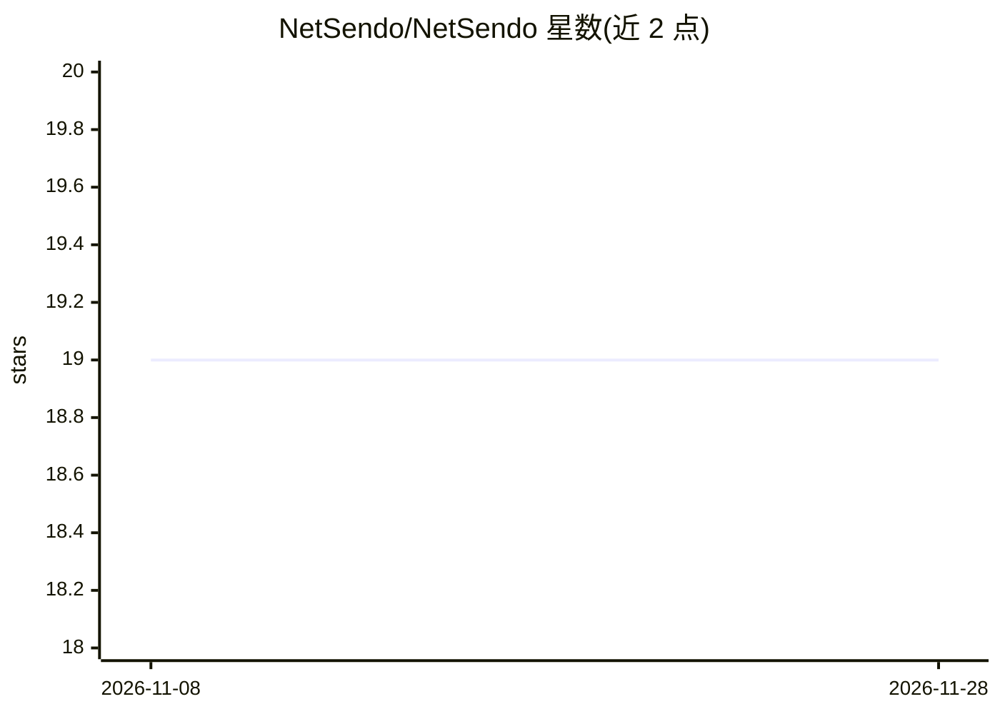

# NetSendo/NetSendo

⭐ 19 · PHP · NOASSERTION · 推送 2026-11-27 · [GitHub](https://github.com/NetSendo/NetSendo) · [官网](https://netsendo.com) · 组织维护

**自托管的邮件/短信营销自动化平台，含 CRM、网络研讨会与 AI 套件**

基于 Laravel、Vue.js/Inertia 与 Docker 的自托管邮件营销与自动化平台：支持 MJML 邮件活动、实时访客追踪（Reverb WebSocket）、数字商品销售（Stripe/Polar/Tpay、Shopify/WooCommerce 订单）、自动化工作流与 CRM。AI 部分包括内容生成、Campaign Auditor 等 AI Suite（用户自带 OpenAI/Anthropic/Gemini/Grok key，OpenRouter 与本地 Ollama 需 GOLD），并内置 MCP Server，可被 Claude、Cursor、ChatGPT 等 AI 应用通过实例地址连接。采用 Source-available EULA，SILVER 免费版加 GOLD 订阅分层。

## 筛选速览

| 维度 | 判定 | 备注 |
|---|---|---|
| AI 角色 | `ai-enhanced` | 去掉 AI 部分产品仍成立 |
| 许可风险 | `none` | NOASSERTION |
| 部署形态 | `self-host` | docker 或自建部署 |
| 模型依赖 | local-ok | 支持本地模型 |
| 硬件要求 | — | 无带数字的原话,不猜 |
| 安装摩擦 | `low` | 无编译、无系统依赖或容器化 |
| 成熟度 | — | 结构信号不足 |

## 能力要点

- AI Suite 内容生成与 Campaign Auditor，支持自带多家模型 key
- 每个安装实例即远程 MCP Server，AI 应用粘贴地址即可连接、无需 API key
- MJML 编辑器、拖放模板构建器与自动化工作流
- 实时访客追踪、电商漏斗与 WooCommerce/Shopify/n8n 集成

## 适用场景

- 自托管邮件与短信营销活动，掌握自己的订阅者数据
- 搭建带 CRM 与销售漏斗的数字商品销售流程
- 让 Claude/ChatGPT 等 AI 助手通过 MCP 直接操作我的营销平台

## 场景标签

`工作流自动化` `AI 写作` · 领域:效率与自动化

## 证据(README 行号)

> L25: NetSendo is a modern email marketing and automation platform that enables:
> L31: - 🤖 **AI Suite** - NetSendo Brain, Campaign Auditor, Advisor and content generation with your own OpenAI, Anthropic
> L32: - 🔌 **MCP Server** - Model Context Protocol integration for AI assistants (Claude, Cursor, VS Code)

## 星数曲线

2026-11-08 19 → 2026-11-28 19（+0）

---
*卡片 v1 · prompt 1.4 · 生成 2026-11-18 · 置信度 high · 依据 README sha `0f84b106ec61` · [字段定义](../../DATASET.md)*
