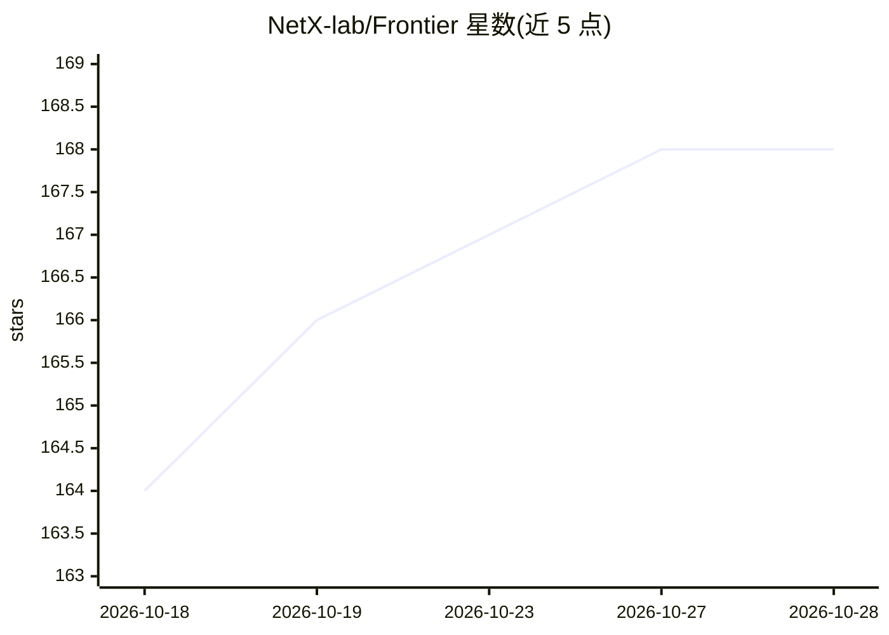

# NetX-lab/Frontier

⭐ 168 · Python · MIT · 推送 2026-10-25 · [GitHub](https://github.com/NetX-lab/Frontier) · 组织维护

**面向现代 LLM 服务的离散事件仿真器，无需 GPU 集群即可做配置研究**

为 LLM serving 系统提供的离散事件仿真器：模拟 vLLM 逻辑的 serving 行为，覆盖协同部署与 PDD/AFD 分离部署、CUDA Graph、投机解码/MTP、前缀缓存、量化、分层缓存等运行时优化，结合标定的算子/通信/KV-cache 内存模型输出可用于部署决策的仿真结果。面向研究人员与工程师做 what-if 研究（SLA Pareto 搜索、异构 GPU 分配、推理调度验证、RL rollout 重配置）。端到端仿真可纯 CPU 运行；针对新硬件收集算子级指标需至少 1 块 GPU 的 profiling 模块。提供 conda 环境与 Docker 镜像，附 arXiv 论文。

## 筛选速览

| 维度 | 判定 | 备注 |
|---|---|---|
| AI 角色 | `ai-ecosystem` | LLM/agent 周边工具 |
| 许可风险 | `permissive` | MIT |
| 部署形态 | `self-host` | docker 或自建部署 |
| 模型依赖 | local-ok | 支持本地模型 |
| 硬件要求 | `cpu-ok` | |
| 安装摩擦 | `low` | 无编译、无系统依赖或容器化 |
| 成熟度 | — | 结构信号不足 |

## 能力要点

- 模拟协同部署与 PDD/AFD 分离部署及多种运行时优化（按运行时行为而非简单加速比建模）
- 端到端仿真可在纯 CPU 机器上运行（利用预编译 profiling 数据库）
- 标定的算子/通信/传输/KV-cache 内存模型，支持 SLA 约束下比较配置
- 支持公式后端一键冒烟运行，可选 ASTRA-Sim 拓扑与 htsim 集合通信后端

## 适用场景

- 在 SLA 约束下搜索最佳 serving 架构与并行配置
- 研究分离部署中异构 GPU 分配的成本效率
- 验证多轮推理负载的调度策略与 RL rollout 的动态并行度重配置

## 场景标签

 · 领域:LLM 推理基础设施/仿真

## 证据(README 行号)

> L21: Frontier is a discrete-event simulator for modern LLM serving. It is built for serving systems that combine complex
> L23: Frontier helps researchers and engineers better understand serving system designs and tradeoffs without the time an
> L35: - **Simulation:** Frontier supports E2E execution entirely on CPU-only machines, leveraging pre-compiled profiling 

## 星数曲线

2026-10-18 164 → 2026-10-28 168（+4）

---
*卡片 v1 · prompt 1.4 · 生成 2026-10-23 · 置信度 high · 依据 README sha `819bb644ff67` · [字段定义](../../DATASET.md)*
