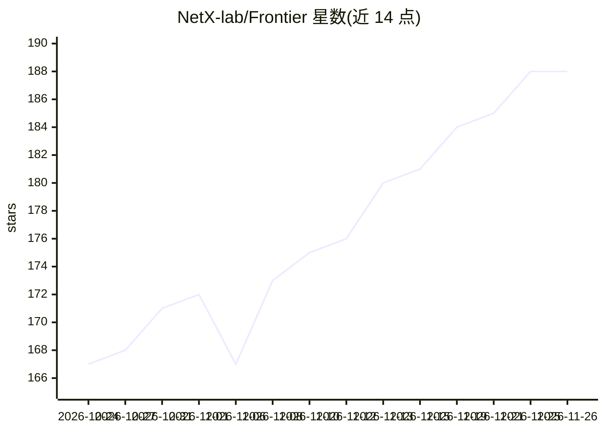

# NetX-lab/Frontier

⭐ 188 · Python · MIT · 推送 2026-11-20 · [GitHub](https://github.com/NetX-lab/Frontier) · 组织维护

**面向研究者的 LLM 推理服务离散事件模拟器**

用于模拟现代 LLM serving 系统的离散事件模拟器，针对复杂并行、运行时优化、MoE 稀疏架构与有状态负载（reasoning agents、RL rollouts）的 serving 设计研究。当前模拟 vLLM 逻辑的 serving 行为。通过校准的算子、通信、传输与 KV-cache 内存模型产出仿真结果，用于在 SLA 约束下比较部署配置，避免在 GPU 集群上反复部署的时间与资金成本。仿真可全 CPU 运行；对新硬件收集 profiling 数据需至少 1 块 GPU，并使用独立的 conda 环境以隔离 vllm/flashinfer 的 CUDA 版本依赖。

## 筛选速览

| 维度 | 判定 | 备注 |
|---|---|---|
| AI 角色 | `ai-ecosystem` | LLM/agent 周边工具 |
| 许可风险 | `permissive` | MIT |
| 部署形态 | `self-host` | docker 或自建部署 |
| 模型依赖 | local-ok | 支持本地模型 |
| 硬件要求 | `cpu-ok` | |
| 安装摩擦 | `low` | 无编译、无系统依赖或容器化 |
| 成熟度 | — | 结构信号不足 |

## 能力要点

- 支持共置、PDD 与 AFD 三类 serving 架构的模拟
- 将 CUDA Graph、投机解码、前缀缓存、量化等建模为运行时行为而非简单加速系数
- 仿真可在纯 CPU 机器上借助预编译 profiling 数据库完整执行
- 提供 SLA 约束下的 Pareto 前沿搜索等四类论文级用例

## 适用场景

- 在 SLA 约束下搜索最优 serving 架构与并行配置
- 评估异构 GPU 分配下 disaggregated serving 的成本效率
- 验证多轮推理与 RL rollout 场景的调度策略
- 在不实际部署的情况下探索大规模 GPU 设计空间

## 场景标签

 · 领域:LLM 基础设施/系统仿真

## 证据(README 行号)

> L21: Frontier is a discrete-event simulator for modern LLM serving. It is built for serving systems that combine complex
> L31: - **Fidelity**: Frontier combines calibrated operator, communication, transfer, and KV-cache memory models to make 

## 星数曲线

2026-10-24 167 → 2026-11-26 188（+21）

---
*卡片 v1 · prompt 1.4 · 生成 2026-11-26 · 置信度 high · 依据 README sha `6efc09635c39` · [字段定义](../../DATASET.md)*
