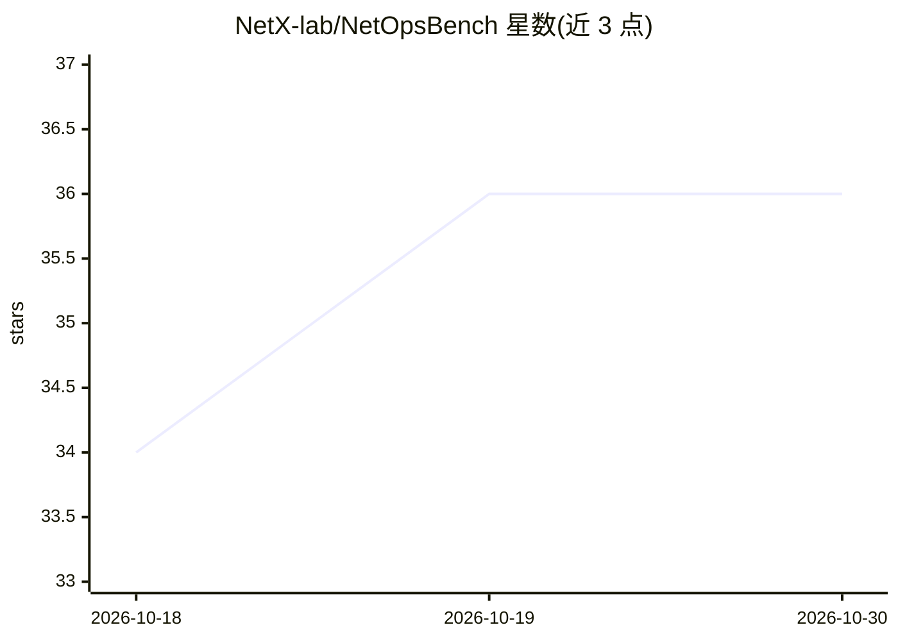

# NetX-lab/NetOpsBench

⭐ 36 · Python · MIT · 推送 2026-08-24 · [GitHub](https://github.com/NetX-lab/NetOpsBench) · [官网](https://netx-lab.github.io/NetOpsBench/) · 组织维护 · 中文 README

**开放智能体网络故障排查基准测试平台**

面向智能体网络故障排查的开放基准竞技场：在 SONiC-VS 与 Containerlab 拓扑上运行可复现的故障场景，接入任意排查智能体，从检测、定位、效率与工具使用维度评分。提供 Python SDK（run_scenario()/run_suite()）、MCP 可观测性工具与场景 YAML 定义；覆盖 CLOS XS 至 Fat-tree K=12 七种规模共 300+ 案例。运行依赖 Linux（Containerlab 依赖 Linux 网络原语）与 Docker。面向研究者与工程师，用于比较 LLM、符号、启发式或混合排查策略。

## 筛选速览

| 维度 | 判定 | 备注 |
|---|---|---|
| AI 角色 | `ai-ecosystem` | LLM/agent 周边工具 |
| 许可风险 | `permissive` | MIT |
| 部署形态 | `None` |  |
| 模型依赖 | — | README 未给出锁定关系 |
| 硬件要求 | — | 无带数字的原话,不猜 |
| 安装摩擦 | `low` | 无编译、无系统依赖或容器化 |
| 成熟度 | — | 结构信号不足 |

## 能力要点

- 在 SONiC-VS/Containerlab 实况拓扑上运行可复现故障场景
- 七种拓扑规模（XS 至 Fat-tree K=12）共 300+ 带标签案例
- Python SDK 与开放架构支持接入自定义排查智能体
- 评估检测准确率、定位、运行时间、工具调用与 token 用量

## 适用场景

- 在同一基准上比较不同 LLM 排查智能体策略
- 用 Python 批量运行故障场景并生成评分报告
- 利用 MCP 工具观察实况网络遥测数据进行排障研究

## 场景标签

`模型评测` · 领域:评测与运维

## 证据(README 行号)

> L17: NetOpsBench is an open benchmark arena for agentic network troubleshooting — run reproducible fault scenarios on li
> L29: NetOpsBench provides: (1) an interactive and realistic environment mimicking production networks, with common traci
> L31: It is built for researchers and engineers who want to compare LLM-backed, symbolic, heuristic, or hybrid troublesho

## 星数曲线

2026-10-18 34 → 2026-10-30 36（+2）

---
*卡片 v1 · prompt 1.4 · 生成 2026-10-25 · 置信度 high · 依据 README sha `7bd2213f1efc` · [字段定义](../../DATASET.md)*
