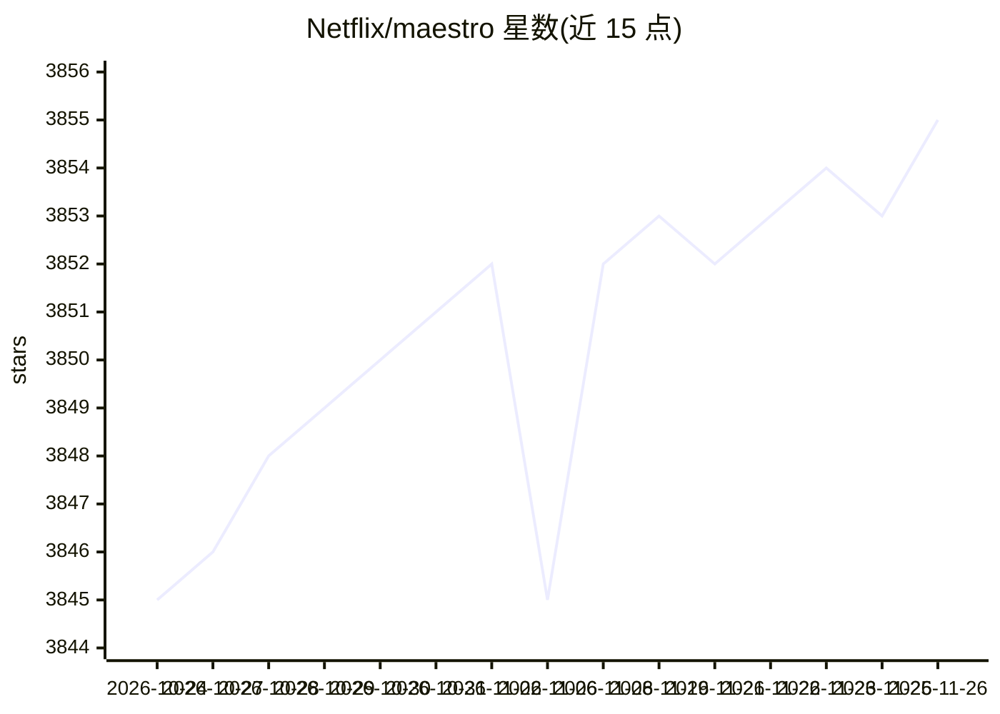

# Netflix/maestro

⭐ 3,855 · Java · Apache-2.0 · 推送 2026-11-06 · [GitHub](https://github.com/Netflix/maestro) · [官网](https://maestro-doc.github.io) · 组织维护

**Netflix 开源的通用工作流编排器，管理数据/ML 流水线**

通用型工作流编排器，为数据平台用户提供工作流即服务；服务数据科学家、数据工程师、ML 工程师、软件工程师、内容制作与业务分析人员。提供基于 DAG 的工作流定义、作业模板、手动/自动触发、实例查询等 REST API；支持 AWS 模块（SNS/SQS）、Kubernetes 运行步骤、foreach 步骤扁平化的扩展服务；附带 Python SDK（pip 安装）用于以代码定义并推送工作流。构建依赖 Java 21、Gradle 与 Git，本地运行可用 Docker Compose 启动 LocalStack。

## 筛选速览

| 维度 | 判定 | 备注 |
|---|---|---|
| AI 角色 | `ai-enhanced` | 去掉 AI 部分产品仍成立 |
| 许可风险 | `permissive` | Apache-2.0 |
| 部署形态 | `self-host` | docker 或自建部署 |
| 模型依赖 | — | README 未给出锁定关系 |
| 硬件要求 | — | 无带数字的原话,不猜 |
| 安装摩擦 | `low` | 无编译、无系统依赖或容器化 |
| 成熟度 | — | 结构信号不足 |

## 能力要点

- 通用工作流编排（DAG 定义、作业模板、版本管理、手动触发）
- REST API 与 Python SDK 两种工作流定义/提交方式
- AWS（SNS/SQS）模块与 Kubernetes 步骤运行支持
- 本地可用 Docker Compose + LocalStack 启动依赖服务

## 适用场景

- 编排数据工程的 ETL/ELT 批处理流水线
- 调度机器学习训练与数据处理工作流
- 通过 Python SDK 以代码方式管理工作流生命周期

## 场景标签

`工作流自动化` `MLOps` · 领域:效率与自动化

## 证据(README 行号)

> L3: is a general-purpose workflow orchestrator that
> L6: It serves thousands of users, including data scientists, data engineers, machine learning engineers,
> L8: It schedules hundreds of thousands of workflows, millions of jobs every day

## 星数曲线

2026-10-24 3,845 → 2026-11-26 3,855（+10）

---
*卡片 v1 · prompt 1.4 · 生成 2026-11-23 · 置信度 mid · 依据 README sha `05a7e88f8414` · [字段定义](../../DATASET.md)*
