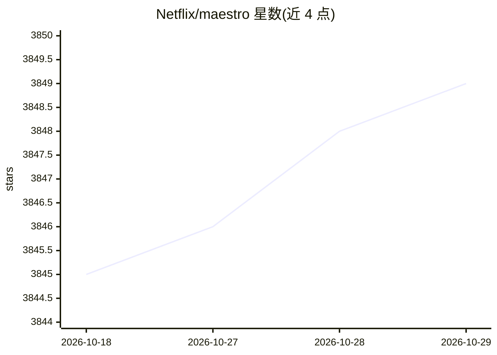

# Netflix/maestro

⭐ 3,849 · Java · Apache-2.0 · 推送 2026-10-27 · [GitHub](https://github.com/Netflix/maestro) · [官网](https://maestro-doc.github.io) · 组织维护

**Netflix 的通用工作流编排器：数据/ML 流水线即服务**

通用目的工作流编排器，为 Netflix 数据平台用户提供工作流即服务（WAAS），面向数据科学家、数据工程师、机器学习工程师等，每日调度数十万工作流。支持 DAG 定义、增量处理、AWS 模块（SQS/SNS/LocalStack）、Kubernetes 执行与 foreach 扩展服务。以 Java 21 + Gradle + Spring Boot 构建，通过 REST API 操作工作流，另提供 Python SDK（pip 安装）用于创建、推送和启动工作流。

## 筛选速览

| 维度 | 判定 | 备注 |
|---|---|---|
| AI 角色 | `ai-ecosystem` | LLM/agent 周边工具 |
| 许可风险 | `permissive` | Apache-2.0 |
| 部署形态 | `self-host` | docker 或自建部署 |
| 模型依赖 | — | README 未给出锁定关系 |
| 硬件要求 | — | 无带数字的原话,不猜 |
| 安装摩擦 | `low` | 无编译、无系统依赖或容器化 |
| 成熟度 | — | 结构信号不足 |

## 能力要点

- 工作流即服务，支持 DAG 定义与 REST API 全生命周期操作
- AWS 模块（SQS/SNS，LocalStack 本地模拟）与 Kubernetes 执行支持
- maestro-extensions 独立服务提供 foreach 步骤扁平化视图
- Python SDK（maestro-sdk）支持以代码定义并推送工作流

## 适用场景

- 编排数据/ML 流水线并按 SLO 大规模调度
- 在 AWS 或 Kubernetes 环境中运行工作流作业
- 用 Python SDK 以代码方式定义和管理工作流

## 场景标签

`工作流自动化` · 领域:效率与自动化

## 证据(README 行号)

> L6: It serves thousands of users, including data scientists, data engineers, machine learning engineers,
> L13: - Maestro: Data/ML Workflow Orchestrator at Netflix

## 星数曲线

2026-10-18 3,845 → 2026-10-29 3,849（+4）

---
*卡片 v1 · prompt 1.4 · 生成 2026-10-20 · 置信度 mid · 依据 README sha `1c36516c8753` · [字段定义](../../DATASET.md)*
