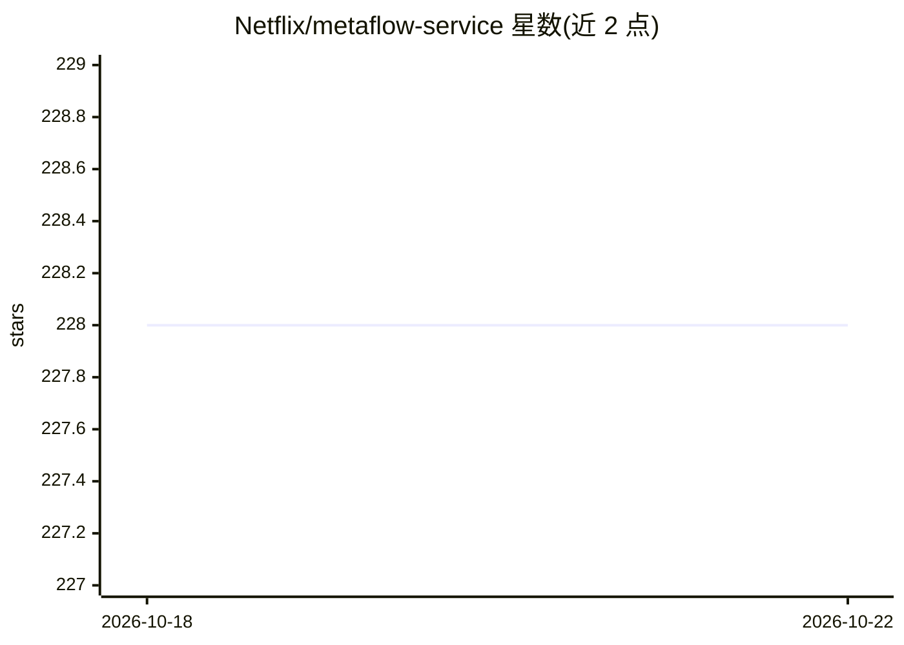

# Netflix/metaflow-service

⭐ 228 · Python · Apache-2.0 · 推送 2026-10-21 · [GitHub](https://github.com/Netflix/metaflow-service) · [官网](http://www.metaflow.org) · 组织维护

**Metaflow 的元数据追踪与 UI 服务，记录 Flow/Run/Task 元数据**

Netflix 维护的 Metaflow 元数据服务：对数据库的薄封装，记录与 Flow、Run、Step、Task、Artifact 等 Metaflow 实体关联的元数据，提供 Metadata 服务（8080 端口，含 Swagger UI）、Migration 服务（8082）与 UI 后端服务（8083）。通过环境变量配置 PostgreSQL 连接，支持 pip 安装本地运行、docker-compose 编排及 DockerHub 官方镜像。镜像内打包多个版本的 metadata 服务，由 migration 服务按数据库 schema 版本决定激活哪个 virtualenv。面向使用或部署 Metaflow 的 ML 基础设施团队。

## 筛选速览

| 维度 | 判定 | 备注 |
|---|---|---|
| AI 角色 | `ai-ecosystem` | LLM/agent 周边工具 |
| 许可风险 | `permissive` | Apache-2.0 |
| 部署形态 | `self-host` | docker 或自建部署 |
| 模型依赖 | — | README 未给出锁定关系 |
| 硬件要求 | — | 无带数字的原话,不猜 |
| 安装摩擦 | `low` | 无编译、无系统依赖或容器化 |
| 成熟度 | — | 结构信号不足 |

## 能力要点

- 跟踪 Flow/Run/Step/Task/Artifact 元数据并提供 Swagger UI
- Metadata、Migration、UI 后端三个服务，可独立运行
- docker-compose 与 DockerHub 官方镜像两种部署方式
- migration 服务按 DB schema 版本自动选择兼容的服务版本

## 适用场景

- 为自部署的 Metaflow 提供元数据存储与查询服务
- 配合 Metaflow 客户端在本地执行 Flow 并记录元数据
- 管理元数据库 schema 迁移与滚动升级

## 场景标签

`MLOps` · 领域:训练与推理

## 证据(README 行号)

> L3: Metadata service implementation for Metaflow.
> L5: This provides a thin wrapper around a database and keeps track of metadata associated with

## 星数曲线

2026-10-18 228 → 2026-10-22 228（+0）

---
*卡片 v1 · prompt 1.4 · 生成 2026-10-22 · 置信度 high · 依据 README sha `061da33d2655` · [字段定义](../../DATASET.md)*
