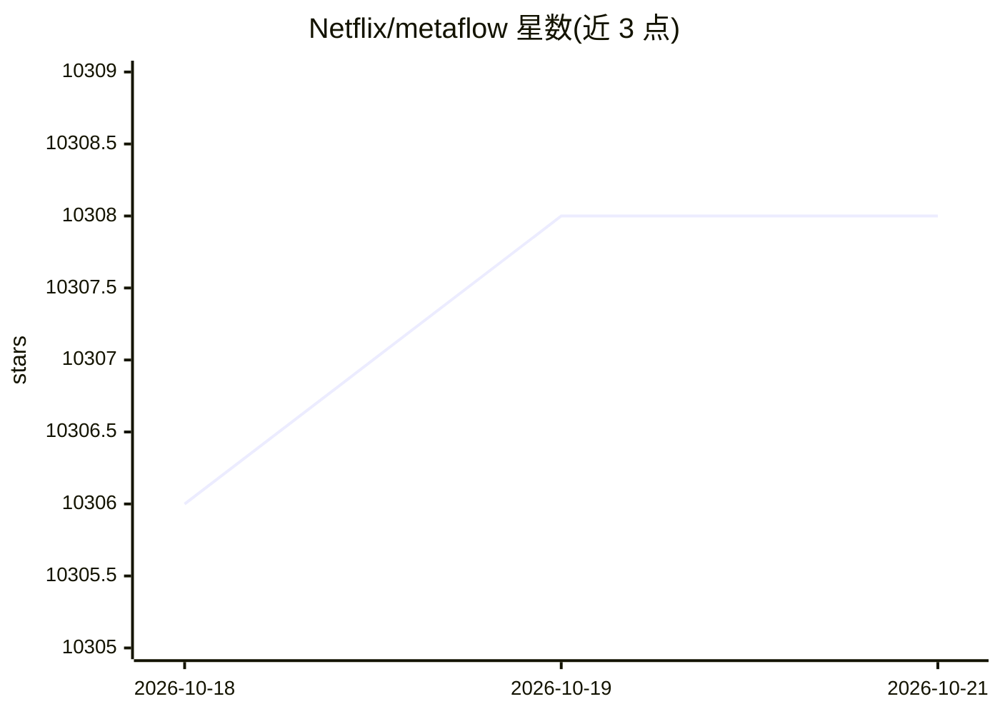

# Netflix/metaflow

⭐ 10,308 · Python · Apache-2.0 · 推送 2026-10-16 · [GitHub](https://github.com/Netflix/metaflow) · [官网](https://metaflow.org) · 组织维护

**Netflix 开源的 AI/ML 系统构建与管理 Python 框架**

面向科学家与工程团队的 Python 框架，用于构建和管理实际 AI/ML 系统：提供 pythonic API 覆盖本地快速原型（支持笔记本、实验跟踪、版本化与可视化）、云端横向/纵向扩展（CPU/GPU、并行与 gang-scheduled 负载），以及依赖管理与一键部署到生产级编排器。最初在 Netflix 开发，现由 Outerbounds 支持；Netflix 内部支撑 3000+ AI/ML 项目。通过 PyPI 与 conda-forge 安装，另有在线 sandbox 可直接试用。

## 筛选速览

| 维度 | 判定 | 备注 |
|---|---|---|
| AI 角色 | `ai-ecosystem` | LLM/agent 周边工具 |
| 许可风险 | `permissive` | Apache-2.0 |
| 部署形态 | `library` | 以包/库形式分发 |
| 模型依赖 | — | README 未给出锁定关系 |
| 硬件要求 | — | 无带数字的原话,不猜 |
| 安装摩擦 | `low` | 无编译、无系统依赖或容器化 |
| 成熟度 | — | 结构信号不足 |

## 能力要点

- 从笔记本原型到生产部署的统一 pythonic API
- 内置实验跟踪、版本化与可视化
- 云端 CPU/GPU 横向纵向扩展，支持并行与 gang-scheduled 负载
- 一键部署到生产级工作流编排器

## 适用场景

- 数据科学团队把笔记本原型平滑迁移到生产流程
- 在自有云上运行大规模并行训练与数据处理任务
- 对 AI/ML 实验做跟踪、版本与制品管理

## 场景标签

`MLOps` `模型训练` · 领域:训练与推理

## 证据(README 行号)

> L5: Metaflow is a human-centric framework designed to help scientists and engineers **build and manage real-life AI and 
> L13: Metaflow provides a simple and friendly pythonic API that covers foundational needs of AI and ML systems:
> L17: 3. Easily manage dependencies and deploy with one-click to highly available production orchestrators with built in 

## 星数曲线

2026-10-18 10,306 → 2026-10-21 10,308（+2）

---
*卡片 v1 · prompt 1.4 · 生成 2026-10-20 · 置信度 high · 依据 README sha `fb89559fc957` · [字段定义](../../DATASET.md)*
