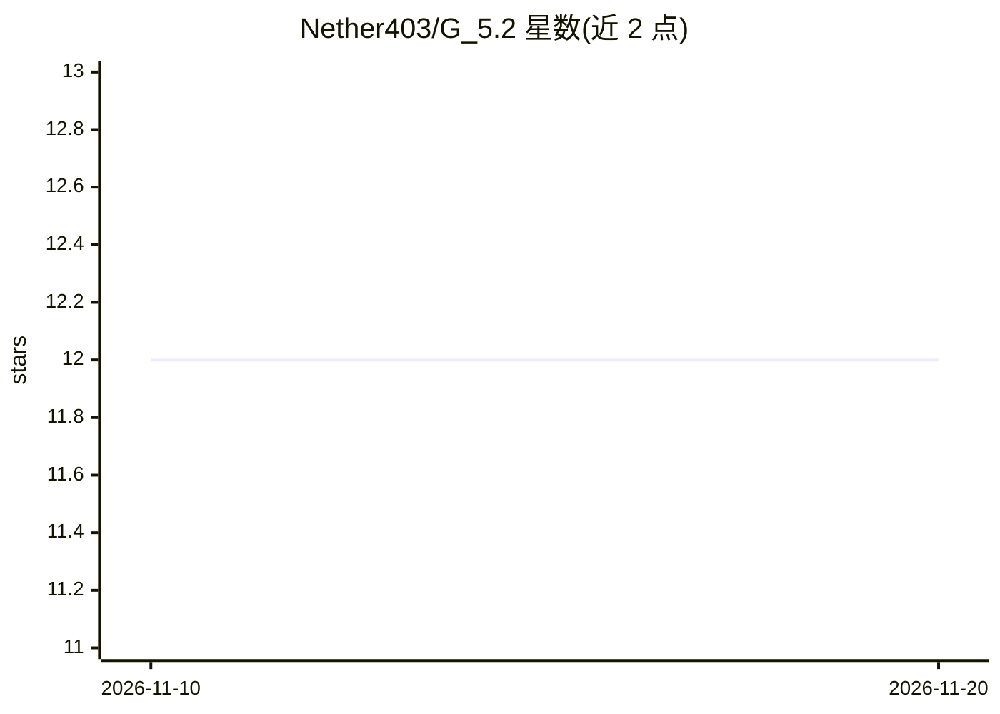

# Nether403/G_5.2

⭐ 12 · TypeScript · MIT · 推送 2026-11-10 · [GitHub](https://github.com/Nether403/G_5.2) · [官网](https://g-52.twpf.online/) · 个人维护

**为多产品轨道提供共享运行时与治理内核的 monorepo**

以 pnpm monorepo 组织的共享运行时与治理内核，支撑 witness（使命级）与 pes（公开/教育级）两条产品轨道。核心机制包括：基于 ProductId 的产品感知运行时选择、OpenRouter 抽象的多次编排响应生成、会话持久化与上下文快照/回放、选择性持久记忆（去重与矛盾检测）、同意门控的 inquiry 流程，以及评估与操作员 dashboard。要求 Node ≥20、pnpm ≥9，依赖 Azure OpenAI/OpenRouter 密钥运行。

## 筛选速览

| 维度 | 判定 | 备注 |
|---|---|---|
| AI 角色 | `ai-ecosystem` | LLM/agent 周边工具 |
| 许可风险 | `permissive` | MIT |
| 部署形态 | `library` | 以包/库形式分发 |
| 模型依赖 | locked-api |  |
| 硬件要求 | — | 无带数字的原话,不猜 |
| 安装摩擦 | `low` | 无编译、无系统依赖或容器化 |
| 成熟度 | — | 结构信号不足 |

## 能力要点

- 产品感知运行时选择（pes/witness 双策略根，存储互不交叉）
- OpenRouter 支持的 provider 抽象与多轮次响应编排
- 会话持久化、上下文快照、回放与迁移保护的 schema 版本管理
- 操作员 dashboard 提供报告、diff、会话与编辑工作流检查

## 适用场景

- 在受治理的运行时中运行 witness 或 pes 两种产品轨道
- 通过 dashboard 检查 inquiry 会话、记忆与编辑工作流
- 用子系统级评估与关键用例门控做回归压力测试

## 场景标签

 · 领域:LLM 基础设施/运行时治理

## 证据(README 行号)

> L3: G_5.2 is the shared runtime and governance kernel behind two product tracks:
> L10: - `packages/orchestration` — shared runtime, retrieval, persistence, memory, editorial, reflection, and product reg
> L38: - multi-pass response orchestration with provider abstraction through OpenRouter-backed providers

## 星数曲线

2026-11-10 12 → 2026-11-20 12（+0）

---
*卡片 v1 · prompt 1.4 · 生成 2026-11-18 · 置信度 low · 依据 README sha `0aaf5a42c8c9` · [字段定义](../../DATASET.md)*
