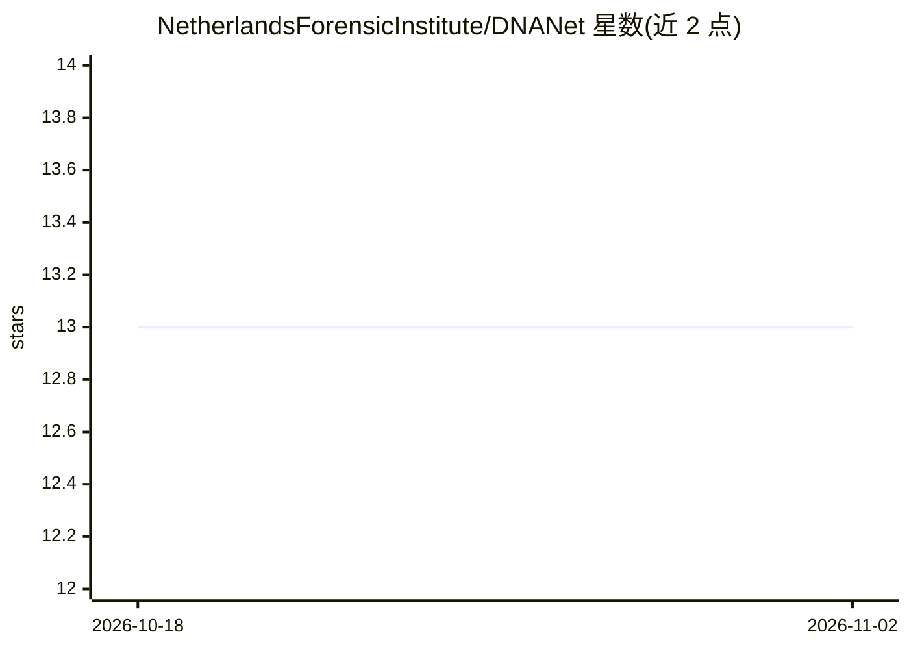

# NetherlandsForensicInstitute/DNANet

⭐ 13 · Python · EUPL-1.2 · 推送 2026-09-28 · [GitHub](https://github.com/NetherlandsForensicInstitute/DNANet) · [官网](https://dnanet.readthedocs.io/en/latest/)

**法医 DNA 电泳图谱深度学习框架：解析 .hid 并等位基因分型**

荷兰法医研究所（NFI）开发的开源 Python 框架，用于法医 DNA 电泳图谱（EPG）分析：解析毛细管电泳 .hid 文件，提供端到端管线，包括 U-Net 像素级信号分割、峰分类（等位基因/影子峰/噪声）、自编码器图谱重建与 Combined PeakNet，可用于 DNA 图谱的等位基因判读。训练与评测通过 Hydra CLI 完成，支持 NFI R&D、ProvedIT 等数据集，依赖 PyTorch 2.5+，要求 Python 3.12–3.14。

## 筛选速览

| 维度 | 判定 | 备注 |
|---|---|---|
| AI 角色 | `ai-native` | 本体是模型或模型工具 |
| 许可风险 | `viral` | EUPL-1.2 |
| 部署形态 | `library` | 以包/库形式分发 |
| 模型依赖 | — | README 未给出锁定关系 |
| 硬件要求 | — | 无带数字的原话,不猜 |
| 安装摩擦 | `low` | 无编译、无系统依赖或容器化 |
| 成熟度 | — | 结构信号不足 |

## 能力要点

- 解析 .hid 文件并调用预训练 U-Net 做 DNA 图谱等位基因判读
- 分割/分类/重建三类任务端到端管线
- Hydra YAML 配置组合与 CLI 训练/评测/交叉验证
- 支持 PowerPlex Fusion 6C、GlobalFiler、PowerPlex Y23 试剂盒扩展策略

## 适用场景

- 法医实验室对 STR 图谱做深度学习等位基因判读
- 在 ProvedIT 基准数据集上训练与评测 EPG 分割模型
- 研究影子峰与噪声的自动峰分类

## 场景标签

 · 领域:法医遗传学/生物信息

## 证据(README 行号)

> L8: Deep learning framework for forensic DNA electropherogram (EPG) analysis.
> L11: This a Python repository that can be used to analyze DNA profiles using deep learning. It contains functionality to
> L42: - **Segmentation** — Binary pixel-level labeling of EPG signals (U-Net + Dice loss)

## 星数曲线

2026-10-18 13 → 2026-11-02 13（+0）

---
*卡片 v1 · prompt 1.4 · 生成 2026-10-31 · 置信度 mid · 依据 README sha `fe9795d03e93` · [字段定义](../../DATASET.md)*
