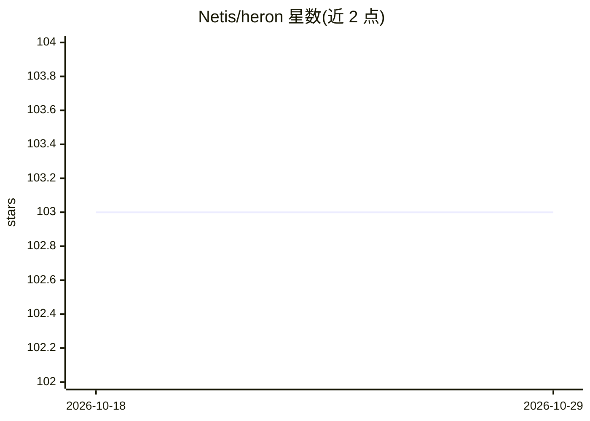

# Netis/heron

⭐ 103 · Rust · Apache-2.0 · 推送 2026-10-12 · [GitHub](https://github.com/Netis/heron) · [官网](https://heron-ai.pages.dev) · 组织维护 · 中文 README

**从网络流量被动重建 LLM/Agent 调用与指标的可观测性工具**

Rust 编写的 agent 与 LLM API 性能监控工具，通过 libpcap 抓包、.pcap 回放、ZMQ 云探针或 Linux eBPF SSL uprobes 采集流量，在提供方一侧解码 OpenAI/Anthropic/Gemini 等 wire API，将多调用 agent 交互重建为可寻址的单个 turn。提供 Web 控制台（localhost:3000）展示 TTFT、延迟、吞吐、错误率、token 指标与服务拓扑图，支持导出 OpenAI 风格 messages JSONL 作为 SFT 训练数据。存储默认 DuckDB，可选 ClickHouse。限制：需看到明文 HTTP（TLS 解密侧部署或 eBPF），跨集群客户端追踪不支持。

## 筛选速览

| 维度 | 判定 | 备注 |
|---|---|---|
| AI 角色 | `ai-ecosystem` | LLM/agent 周边工具 |
| 许可风险 | `permissive` | Apache-2.0 |
| 部署形态 | `None` |  |
| 模型依赖 | local-ok | 支持本地模型 |
| 硬件要求 | — | 无带数字的原话,不猜 |
| 安装摩擦 | `low` | 无编译、无系统依赖或容器化 |
| 成熟度 | `idea` | |

## 能力要点

- 零 SDK/零代理的被动抓包监控，解析器不在请求路径上
- 将 planner→tool→result 多调用交互重建为单个 agent turn
- 从流量字节分类 vLLM/SGLang/Ollama/llama.cpp/LiteLLM 等端点
- turn/session 一键导出为 OpenAI 风格 messages JSONL（SFT 数据）
- Linux eBPF SSL uprobes 可读 TLS 加密流量并按进程归属（实验性）

## 适用场景

- 调试 agent 卡住的工具调用、计划循环等失败，无需改动 agent 或 SDK
- 推理平台查看 clients→litellm→vLLM/SGLang 的服务拓扑与各跳性能
- 把真实捕获的 agent 运行转为 SFT 微调数据集
- 合规留证：按 agent 与会话记录每次请求/响应

## 场景标签

`LLM 可观测性` · 领域:评测与运维

## 证据(README 行号)

> L5: Passive agent observability — reconstructed from the traffic itself, off the wire
> L62: See your inference fleet as a **directed graph**: clients → litellm proxies →
> L83: |Approach|In request path|Needs client changes|Sees full bodies|Reconstructs turns|Exports SFT data|

## 星数曲线

2026-10-18 103 → 2026-10-29 103（+0）

---
*卡片 v1 · prompt 1.4 · 生成 2026-10-23 · 置信度 high · 依据 README sha `cb204c2f0dc2` · [字段定义](../../DATASET.md)*
