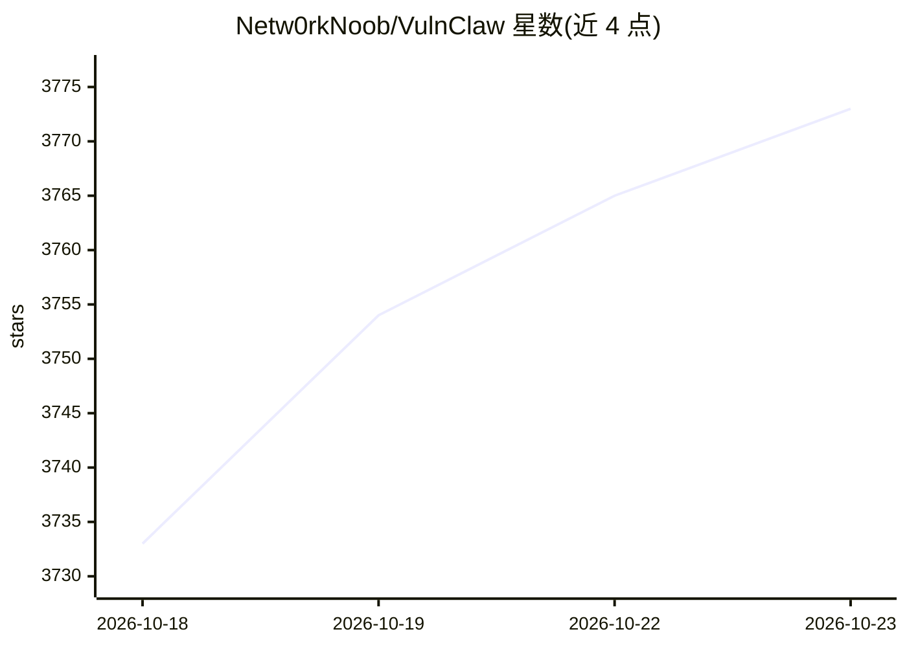

# Netw0rkNoob/VulnClaw

⭐ 3,773 · Python · MIT · 推送 2026-10-12 · [GitHub](https://github.com/Netw0rkNoob/VulnClaw) · [官网](https://unclecheng-li.github.io/vulnclaw.com) · 个人维护 · 中文 README

**自然语言驱动的 AI 渗透测试 CLI，自动完成全流程测试**

AI 渗透测试 Agent，以自然语言输入目标后由模型主导自主循环，自动执行信息收集、漏洞发现、漏洞利用与报告生成。支持 13 个 LLM Provider 一键切换，提供 4 个 MCP 服务（fetch/memory 开箱即用，chrome-devtools/burp 需部署）、50 个专项 Skill 参考索引、AgentState 证据记忆与证据级反幻觉闸门（flag/结论须在真实工具输出中出现）。使用形式覆盖 CLI/REPL、Rust TUI 工作台、单命令、持续性周期渗透与本地 Web UI（127.0.0.1:7788）。适用于已授权渗透测试、CTF、安全教学与红队演练。

## 筛选速览

| 维度 | 判定 | 备注 |
|---|---|---|
| AI 角色 | `ai-native` | 本体是模型或模型工具 |
| 许可风险 | `permissive` | MIT |
| 部署形态 | `desktop` | 安装包/桌面程序 |
| 模型依赖 | local-ok | 支持本地模型 |
| 硬件要求 | — | 无带数字的原话,不猜 |
| 安装摩擦 | `low` | 无编译、无系统依赖或容器化 |
| 成熟度 | — | 结构信号不足 |

## 能力要点

- 模型主导 solve 引擎，模型自主决定工具调用与完成时机
- 13 个 LLM Provider（含本地 Ollama）一键切换
- 证据级反幻觉闸门：声称的 flag 须逐字符出现在真实工具输出
- 生成结构化 Markdown 报告与可运行 Python PoC 脚本
- CLI/TUI/单命令/持续性渗透/Web UI 五种使用方式

## 适用场景

- 对已授权靶场用自然语言描述意图，自动完成渗透全流程
- CTF 竞赛中让 Agent 自主解题并核验 flag 出处
- 红队演练中长周期持续性渗透并按周期生成报告
- 本地源码安全扫描（正则/结构/LLM 三级）

## 场景标签

`网络安全` · 领域:学习与行业

## 证据(README 行号)

> L19: **本项目是可独立运行的 AI 渗透测试 Agent。**
> L25: 自然语言输入 → 自动完成「信息收集 → 漏洞发现 → 漏洞利用 → 报告生成」全流程。
> L53: - **13 个 LLM Provider** — OpenAI / Anthropic / MiniMax / DeepSeek / 智谱 / Moonshot / 千问 / SiliconFlow / 豆包 / 阶跃星辰 / 

## 星数曲线

2026-10-18 3,733 → 2026-10-23 3,773（+40）

---
*卡片 v1 · prompt 1.4 · 生成 2026-10-20 · 置信度 high · 依据 README sha `47cf3dae019c` · [字段定义](../../DATASET.md)*
