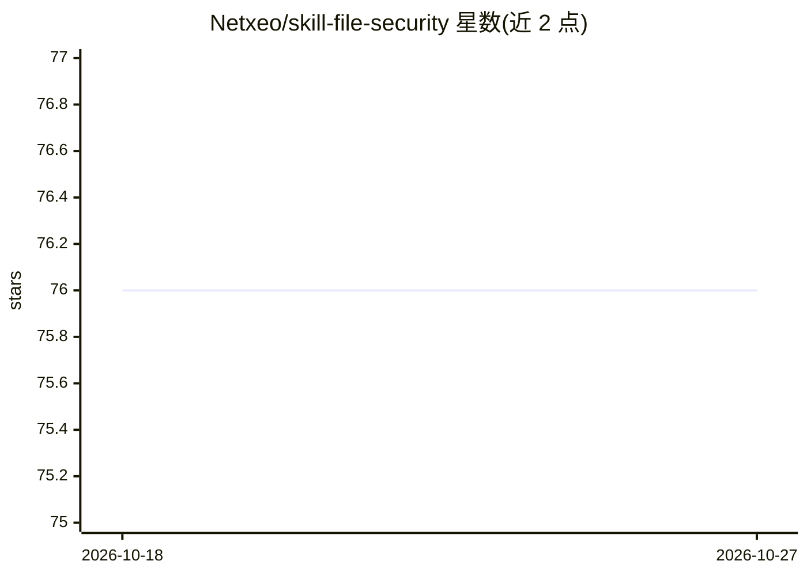

# Netxeo/skill-file-security

⭐ 76 · JavaScript · 推送 2026-06-22 · [GitHub](https://github.com/Netxeo/skill-file-security) · [官网](https://security.ai-dev-skills.com/) · 组织维护

**一条命令为 AI 编程助手注入 29 项安全检查技能**

面向使用 AI 编程助手的开发者：通过 npx 安装器把 29 个安全指令文件写入 .skills/security/，并自动配置 Claude、Cursor、GitHub Copilot、Windsurf、Cline、Codex CLI 等 9 类助手的规则文件。安装后可在对话中使用 /security-scan、/security-audit、/security-fix 等斜杠命令，让助手在编码时按 CWE Top 25、OWASP 七类清单检查漏洞，并用 memory-security.md 记录历次评分。不执行自动修改，修复前需用户确认；无配置、无 API key、无云服务。

## 筛选速览

| 维度 | 判定 | 备注 |
|---|---|---|
| AI 角色 | `ai-ecosystem` | LLM/agent 周边工具 |
| 许可风险 | `permissive` | — |
| 部署形态 | `library` | 以包/库形式分发 |
| 模型依赖 | locked-api |  |
| 硬件要求 | — | 无带数字的原话,不猜 |
| 安装摩擦 | `low` | 无编译、无系统依赖或容器化 |
| 成熟度 | — | 结构信号不足 |

## 能力要点

- npx 单命令安装 29 个安全指令文件并自动适配 9 类 AI 编程助手
- 覆盖 CWE Top 25 与 OWASP 七份清单（Web/API/Mobile/LLM/Docker/Serverless/Cloud-Native）
- 提供 /security-scan、/security-audit、/security-fix、/security-incident 等命令
- memory-security.md 记录安全评分历史，支持自定义规则

## 适用场景

- 让我常用的 AI 编程助手在写代码时顺手做安全检查
- 在 IDE 内用 /security-audit 生成带评分的安全审计报告
- 按项目技术栈只安装所需的安全规则

## 场景标签

`网络安全` `提示工程` · 领域:Agent 开发

## 证据(README 行号)

> L140: 1.  npx @netxeo/security-skill
> L127: |Claude / Antigravity|`CLAUDE.md` + `.claude/commands/` (slash commands)|

## 星数曲线

2026-10-18 76 → 2026-10-27 76（+0）

---
*卡片 v1 · prompt 1.4 · 生成 2026-10-24 · 置信度 high · 依据 README sha `077c718dba23` · [字段定义](../../DATASET.md)*
