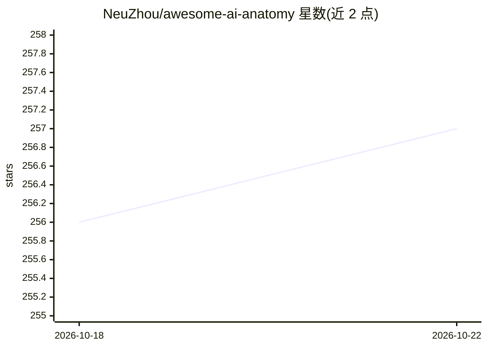

# NeuZhou/awesome-ai-anatomy

⭐ 257 · D2 · MIT · 推送 2026-04-13 · [GitHub](https://github.com/NeuZhou/awesome-ai-anatomy) · [官网](https://neuzhou.github.io/awesome-ai-anatomy) · 个人维护 · 中文 README

**15+ 个 AI 编程 agent 的源码解剖清单与知识库**

对 16 个 AI agent 项目（Claude Code、Dify、OpenHands、Cline、Codex CLI 等）做源码级解剖的策展仓库：每篇 teardown 提供架构图、设计模式、安全态势分析与逐条核验记录，并附带跨项目对比文件（COMPARISON.md、CROSS-CUTTING.md）与结构化知识库。面向想理解 agent 内部工程实现的开发者与架构师。所有声明均标注源码文件路径与行号，仅供教育用途，不含被分析项目的源码。

## 筛选速览

| 维度 | 判定 | 备注 |
|---|---|---|
| AI 角色 | `ai-knowledge` | 知识聚合/清单类 |
| 许可风险 | `permissive` | MIT |
| 部署形态 | `library` | 以包/库形式分发 |
| 模型依赖 | — | README 未给出锁定关系 |
| 硬件要求 | — | 无带数字的原话,不猜 |
| 安装摩擦 | `low` | 无编译、无系统依赖或容器化 |
| 成熟度 | — | 结构信号不足 |

## 能力要点

- 16 个 agent 项目的源码级 teardown，含架构图与代码引用
- 每篇含安全态势、trade-off 分析与逐条事实核验记录
- 跨项目对比与横切分析（设计模式、反模式目录）
- 每周二更新，附 newsletter 订阅

## 适用场景

- 选型前深入理解某 agent 框架的真实架构与限制
- 学习 agent 设计模式与常见反模式
- 了解知名闭源/开源 agent 的安全态势

## 场景标签

`精选清单` `教程课程` · 领域:学习与行业

## 证据(README 行号)

> L27: 15 AI agent projects dissected - architecture diagrams, design patterns, and the engineering decisions nobody docum
> L53: |#|Project|Stars|Language|Lines|Key Findings|Status|

## 星数曲线

2026-10-18 256 → 2026-10-22 257（+1）

---
*卡片 v1 · prompt 1.4 · 生成 2026-10-22 · 置信度 mid · 依据 README sha `0cf8cfd0d113` · [字段定义](../../DATASET.md)*
