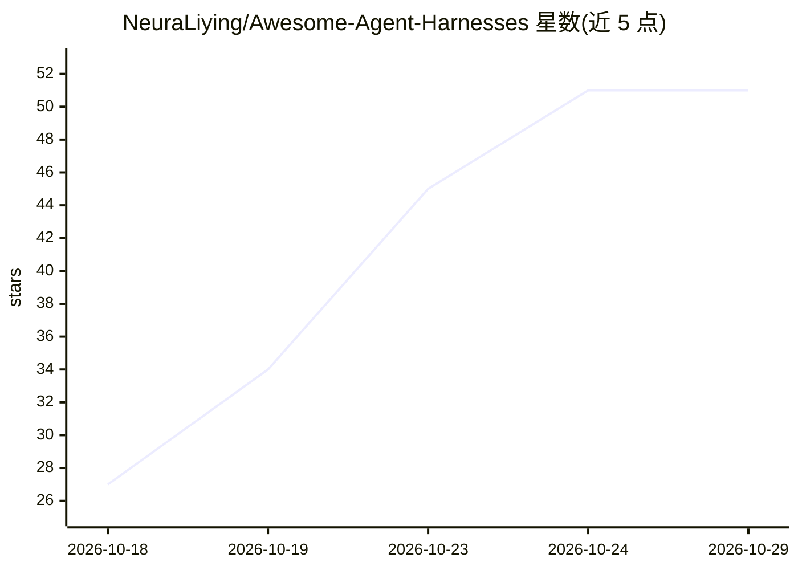

# NeuraLiying/Awesome-Agent-Harnesses

⭐ 51 · MIT · 推送 2026-10-26 · [GitHub](https://github.com/NeuraLiying/Awesome-Agent-Harnesses) · 个人维护

**LLM agent harness 研究与工程的策展综述清单（论文+产品+文章）**

围绕 agent harness（模型外层的循环、工具、记忆、上下文、运行时与安全）这一抽象层的策展清单，共收录 208 篇论文与 67 个生产级 harness、文章与演讲。内容按 harness 组件组织：生产 harness（Claude Code、Codex、Cursor、OpenHands 等 24 个）、影响力文章 43 篇、综述与立场论文等，每条附 URL、年份、机构与简介。供研究 LLM agent 架构的人员查阅，无安装或运行实体，纯阅读型清单。

## 筛选速览

| 维度 | 判定 | 备注 |
|---|---|---|
| AI 角色 | `ai-knowledge` | 知识聚合/清单类 |
| 许可风险 | `permissive` | MIT |
| 部署形态 | `None` |  |
| 模型依赖 | — | README 未给出锁定关系 |
| 硬件要求 | — | 无带数字的原话,不猜 |
| 安装摩擦 | `low` | 无编译、无系统依赖或容器化 |
| 成熟度 | — | 结构信号不足 |

## 能力要点

- 收录 208 篇论文 + 67 个生产 harness/文章/演讲，标注更新日期
- 按 harness 组件组织条目（agent loop、工具、记忆、多智能体编排、评测等）
- 收录 24 个生产级 harness（Claude Code、Codex、Cursor、OpenHands 等）附星数与简介
- 汇集 Anthropic/OpenAI/Karpathy 等来源的权威定义与文章

## 适用场景

- 系统查阅 LLM agent harness 的研究与工程文献
- 对比生产级 coding agent harness 的实现与出处
- 按组件（loop/工具/记忆/评测）定位特定方向的论文与文章

## 场景标签

`精选清单` · 领域:学习与行业

## 证据(README 行号)

> L3: A curated, multiply-verified survey of **agent harness** research and engineering — the right level of abstraction f
> L5: **Total: 208 papers · 67 production harnesses / essays / talks · last updated 2026-10-14**
> L40: ## Table of Contents

## 星数曲线

2026-10-18 27 → 2026-10-29 51（+24）

---
*卡片 v1 · prompt 1.4 · 生成 2026-10-24 · 置信度 high · 依据 README sha `94a9a6ebbc1c` · [字段定义](../../DATASET.md)*
