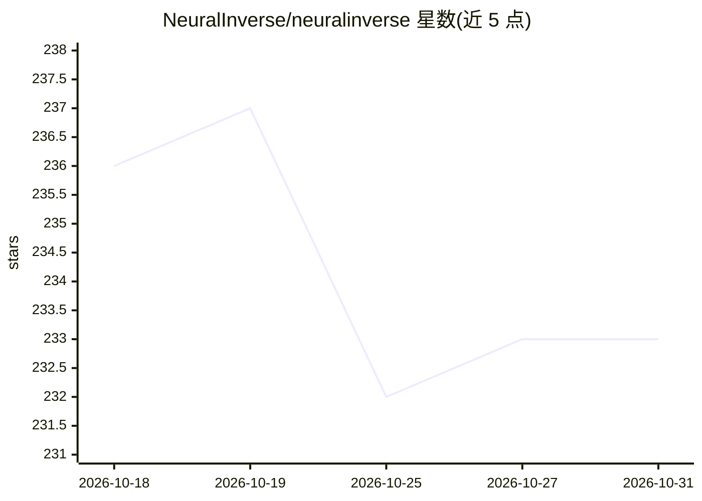

# NeuralInverse/neuralinverse

⭐ 233 · TypeScript · Apache-2.0 · 推送 2026-10-19 · [GitHub](https://github.com/NeuralInverse/neuralinverse) · [官网](https://cloud.neuralinverse.com) · 组织维护

**面向固件与遗留系统现代化的开源 AI 原生 IDE（VS Code 分发版）**

Neural Inverse OSS 是基于 VS Code 代码库的开源编辑器（Apache 2.0），面向嵌入式工程师与企业架构师，定位为开源 Cursor 替代。功能包括 AI 聊天与内联编辑、带 22+ 工具和并发子代理的自主编码代理（Power Mode）、支持 20 个 LLM 提供商（含本地与网关）、357 种 MCU 变体的固件开发模块、30+ 源语言的 5 阶段遗留迁移管线，并提供浏览器版 Cloud。注意：本仓库开发已停止，商业版 Build/Govern 为独立产品。

## 筛选速览

| 维度 | 判定 | 备注 |
|---|---|---|
| AI 角色 | `ai-native` | 本体是模型或模型工具 |
| 许可风险 | `permissive` | Apache-2.0 |
| 部署形态 | `library` | 以包/库形式分发 |
| 模型依赖 | — | README 未给出锁定关系 |
| 硬件要求 | — | 无带数字的原话,不猜 |
| 安装摩擦 | `low` | 无编译、无系统依赖或容器化 |
| 成熟度 | — | 结构信号不足 |

## 能力要点

- AI 聊天、内联编辑、自动补全与自主编码代理 Power Mode
- 支持 20 个 LLM 提供商（云端/本地/网关），API 密钥不上传
- 固件模块覆盖 357 种 MCU 变体、SVD 寄存器映射、MISRA/CERT-C 合规
- 5 阶段遗留迁移管线，支持 30+ 源语言与 61 个翻译配置

## 适用场景

- 在 IDE 内通过 AI 代理完成固件与嵌入式开发
- 把遗留代码库分阶段迁移到现代语言
- 自带 LLM API 密钥做日常 AI 辅助编码

## 场景标签

`编码 Agent` `代码生成` · 领域:编码与开发

## 证据(README 行号)

> L26: NeuralInverse is an AI-native IDE built for the work most AI tools ignore — modernizing legacy systems, developing 
> L28: NeuralInverse combines the editing experience of VS Code with purpose-built tooling for embedded engineers, enterpr
> L51: - **Bring Your Own LLM** — 20 providers (cloud, local, gateway), per-feature model selection, zero lock-in

## 星数曲线

2026-10-18 236 → 2026-10-31 233（-3）

---
*卡片 v1 · prompt 1.4 · 生成 2026-10-22 · 置信度 high · 依据 README sha `bcb4259e21ab` · [字段定义](../../DATASET.md)*
