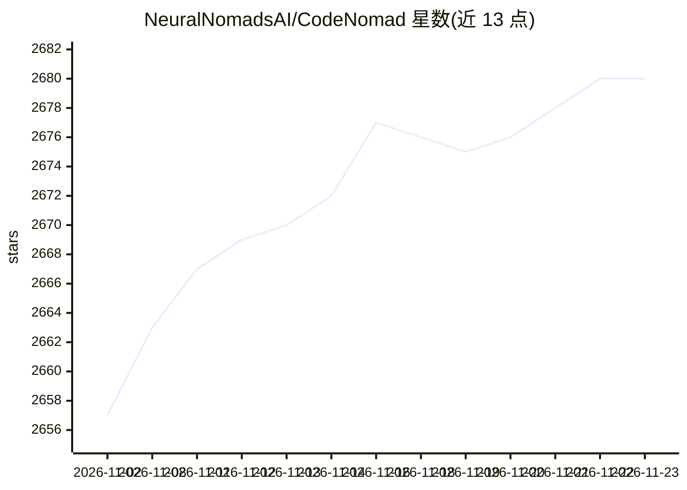

# NeuralNomadsAI/CodeNomad

⭐ 2,680 · TypeScript · MIT · 推送 2026-11-22 · [GitHub](https://github.com/NeuralNomadsAI/CodeNomad) · [官网](https://neuralnomadsai.github.io/CodeNomad/) · 组织维护

**为 OpenCode V2 编码代理提供的桌面/浏览器工作台**

面向多项目、长会话与 Git worktree 工作流的 OpenCode V2 前端工作台：连接 OpenCode 共享后台服务，提供项目标签页、嵌套会话与完整历史导航、会话分叉、worktree 创建与会话迁移、Markdown/代码/diff 渲染、文件附件与 @ 引用、语音输入、命令面板与多语言界面。支持远程访问：服务器以 npm 包运行，浏览器或桌面客户端通过密码与 HTTPS 连接，或经 OpenTunnel 中继配对手机。桌面版提供 Electron 与 Tauri 两种构建。

## 筛选速览

| 维度 | 判定 | 备注 |
|---|---|---|
| AI 角色 | `ai-ecosystem` | LLM/agent 周边工具 |
| 许可风险 | `permissive` | MIT |
| 部署形态 | `desktop` | 安装包/桌面程序 |
| 模型依赖 | — | README 未给出锁定关系 |
| 硬件要求 | — | 无带数字的原话,不猜 |
| 安装摩擦 | `low` | 无编译、无系统依赖或容器化 |
| 成熟度 | — | 结构信号不足 |

## 能力要点

- 嵌套会话、分叉、全历史时间线导航与超载消息搜索
- Git worktree 创建、选择与会话整体迁移，应用内查看变更
- 浏览器/桌面远程访问，密码认证与 HTTPS，OpenTunnel 免开端口配对
- SideCar 机制可在应用内以标签页打开服务器侧 Web 工具（如 VSCode、ttyd）

## 适用场景

- 在统一界面管理多个项目的编码代理会话
- 在长对话中跳转、分叉并检索历史消息
- 通过浏览器或手机远程接入开发机上的代理会话
- 在应用内直接管理 Git worktree 与代码变更

## 场景标签

`编码 Agent` · 领域:编码与开发

## 证据(README 行号)

> L3: ## The AI Coding Cockpit for OpenCode
> L5: CodeNomad is a **desktop and browser workspace for OpenCode V2** — built for developers who work across projects, lo
> L91: - **One shared OpenCode service** owns sessions and messages. Closing a CodeNomad tab, window, or backend leaves th

## 星数曲线

2026-11-02 2,657 → 2026-11-23 2,680（+23）

---
*卡片 v1 · prompt 1.4 · 生成 2026-11-23 · 置信度 mid · 依据 README sha `c1eb6cea228b` · [字段定义](../../DATASET.md)*
