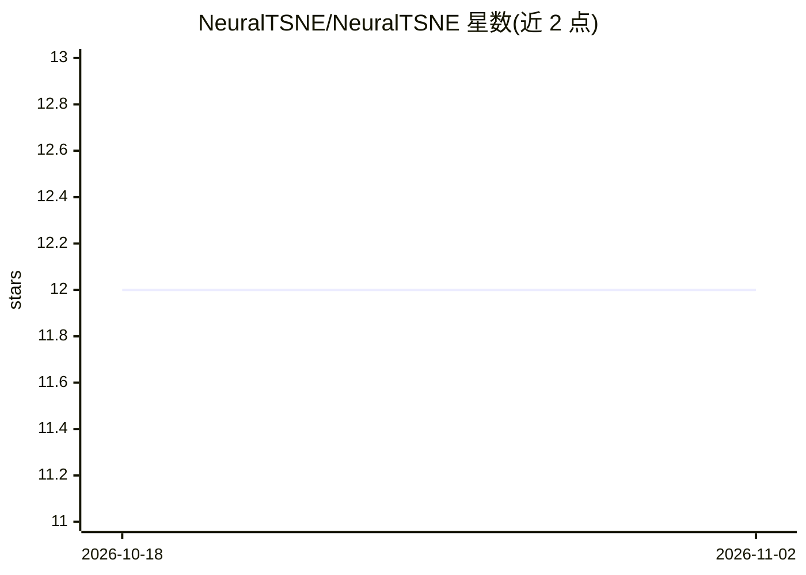

# NeuralTSNE/NeuralTSNE

⭐ 12 · Python · MIT · 推送 2026-07-07 · [GitHub](https://github.com/NeuralTSNE/NeuralTSNE) · [官网](https://NeuralTSNE.github.io/NeuralTSNE/) · 组织维护

**PyTorch 实现的参数化 t-SNE 降维 Python 包**

NeuralTSNE 提供基于神经网络的参数化 t-SNE 实现：用 PyTorch 学习从高维数据到低维空间的映射，借助 Lightning 库封装训练流程，支持 CUDA GPU 加速。可以 Python 模块导入或命令行工具方式使用，示例代码在 examples 目录中提供。项目获波兰国家科学中心 Sonata 项目资助，与原子模拟慢集体变量的统计学习研究相关。

## 筛选速览

| 维度 | 判定 | 备注 |
|---|---|---|
| AI 角色 | `ai-native` | 本体是模型或模型工具 |
| 许可风险 | `permissive` | MIT |
| 部署形态 | `library` | 以包/库形式分发 |
| 模型依赖 | — | README 未给出锁定关系 |
| 硬件要求 | — | 无带数字的原话,不猜 |
| 安装摩擦 | `medium` | 含编译或系统依赖之一 |
| 成熟度 | — | 结构信号不足 |

## 能力要点

- 神经网络学习高维到低维映射的参数化 t-SNE
- 基于 PyTorch 并集成 Lightning 简化训练
- CUDA 支持加速计算
- 可用作 Python 模块或命令行工具

## 适用场景

- 高维数据的可视化降维
- 将 t-SNE 映射应用于新样本的参数化嵌入
- 科研场景中替代非参数 t-SNE 做可复用降维

## 场景标签

 · 领域:数据科学/机器学习

## 证据(README 行号)

> L3: NeuralTSNE is a parametric t-SNE implementation that uses neural networks to learn the mapping from high-dimensional
> L29: The project is supported by the National Science Center in Poland (Sonata 2021/43/D/ST4/00920, ``Statistical Learni

## 星数曲线

2026-10-18 12 → 2026-11-02 12（+0）

---
*卡片 v1 · prompt 1.4 · 生成 2026-11-01 · 置信度 high · 依据 README sha `b50d23c9a867` · [字段定义](../../DATASET.md)*
