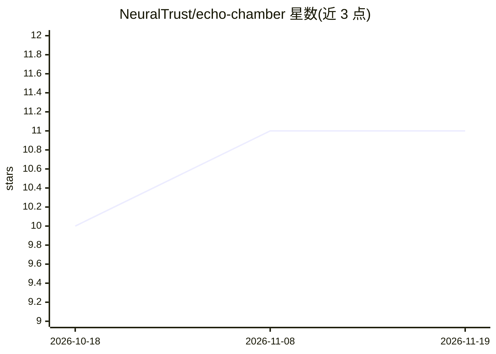

# NeuralTrust/echo-chamber

⭐ 11 · Jupyter Notebook · MIT · 推送 2025-11-24 · [GitHub](https://github.com/NeuralTrust/echo-chamber) · [官网](https://neuraltrust.ai) · 组织维护

**Echo Chamber 越狱攻击的实验代码与评测示例库**

NeuralTrust 发布的 Echo Chamber LLM 越狱攻击研究的代码与示例库：提供 run_experiment.py 脚本运行实验，experiments/results 目录存放实验结果，jailbreak_examples 目录收录跨多个 AI 模型的越狱示例。内置 GoogleClient、OpenAiClient、OllamaClient 三种 LLM 客户端，可通过继承 LLMClient 基类实现自定义客户端；支持用 OpenAiClient 作为 judge LLM 对测试集做评测。以 Python 包形式安装，开发侧提供 ruff、pyrefly 与 pre-commit 工具链。

## 筛选速览

| 维度 | 判定 | 备注 |
|---|---|---|
| AI 角色 | `ai-native` | 本体是模型或模型工具 |
| 许可风险 | `permissive` | MIT |
| 部署形态 | `library` | 以包/库形式分发 |
| 模型依赖 | local-ok | 支持本地模型 |
| 硬件要求 | — | 无带数字的原话,不猜 |
| 安装摩擦 | `low` | 无编译、无系统依赖或容器化 |
| 成熟度 | — | 结构信号不足 |

## 能力要点

- 提供实验运行脚本与结果目录的完整实验流程
- 内置 Google/OpenAI/Ollama 三种 LLM 客户端，可继承 LLMClient 自定义
- 支持以 LLM 作为 judge 对测试集进行评测
- 附带跨多个模型的越狱示例目录

## 适用场景

- 复现或运行 Echo Chamber 越狱攻击实验
- 评估不同 LLM 在该攻击下的表现
- 基于 LLMClient 基类接入自选模型做安全研究

## 场景标签

`模型评测` `网络安全` · 领域:评测与运维

## 证据(README 行号)

> L3: Code and examples for Echo Chamber LLM Jailbreak.
> L28: from echo_chamber.attack import EchoChamberAttack, Objective
> L37: judge_llm = OpenAiClient(model="gpt-4.1", temperature=0.2)

## 星数曲线

2026-10-18 10 → 2026-11-19 11（+1）

---
*卡片 v1 · prompt 1.4 · 生成 2026-11-19 · 置信度 high · 依据 README sha `19c172b3ce1c` · [字段定义](../../DATASET.md)*
