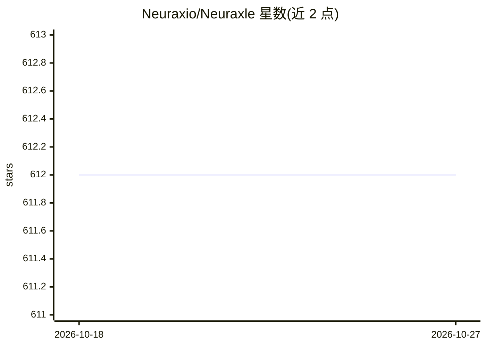

# Neuraxio/Neuraxle

⭐ 612 · Python · Apache-2.0 · 推送 2026-02-20 · [GitHub](https://github.com/Neuraxio/Neuraxle) · [官网](https://www.neuraxle.org/) · 组织维护

**给 ML 开发者的流水线框架：组件化构建与调参生产管线**

Neuraxle 是一个 Python 机器学习库，提供组件化的流水线抽象：每一步为可封装的 step，可各自拥有超参数空间，通过 AutoML 循环（如 TPE）做超参数优化。流水线步骤支持 fit/evolve、保存管理、train/test 生命周期模式，并可用多进程队列并行转换数据。兼容 Scikit-Learn 模型（SKLearnWrapper），可经 Neuraxle-TensorFlow 的 Tensorflow2ModelStep 混入 TensorFlow 模型。以 pip 安装，Apache 2.0 许可。

## 筛选速览

| 维度 | 判定 | 备注 |
|---|---|---|
| AI 角色 | `ai-ecosystem` | LLM/agent 周边工具 |
| 许可风险 | `permissive` | Apache-2.0 |
| 部署形态 | `library` | 以包/库形式分发 |
| 模型依赖 | — | README 未给出锁定关系 |
| 硬件要求 | — | 无带数字的原话,不猜 |
| 安装摩擦 | `low` | 无编译、无系统依赖或容器化 |
| 成熟度 | — | 结构信号不足 |

## 能力要点

- 组件化流水线：封装 step 组合为复杂管线，每步可有自己的超参数空间
- 内置 AutoML 循环（含 TreeParzenEstimator/TPE）做超参数优化与模型选择（ChooseOneStepOf）
- SKLearnWrapper 包装 Scikit-Learn 模型，Tensorflow2ModelStep 接入 TensorFlow
- 多进程队列的流式并行流水线与步骤自管理保存

## 适用场景

- 构建从研究到生产可复用的 ML 流水线
- 在决策树、随机森林、逻辑回归与 TensorFlow 模型间做 AutoML 超参搜索与选型
- 组织时间序列等数据处理管线（WindowTimeSeries、DataShuffler 等 step）

## 场景标签

`MLOps` · 领域:训练与推理

## 证据(README 行号)

> L27: Neuraxle is a Machine Learning (ML) library for building clean machine learning pipelines using the right abstracti
> L31: - **Hyperparameter Tuning**: Optimize your pipelines using AutoML, where each pipeline step has their own hyperpara

## 星数曲线

2026-10-18 612 → 2026-10-27 612（+0）

---
*卡片 v1 · prompt 1.4 · 生成 2026-10-21 · 置信度 high · 依据 README sha `67f4ae6cb37e` · [字段定义](../../DATASET.md)*
