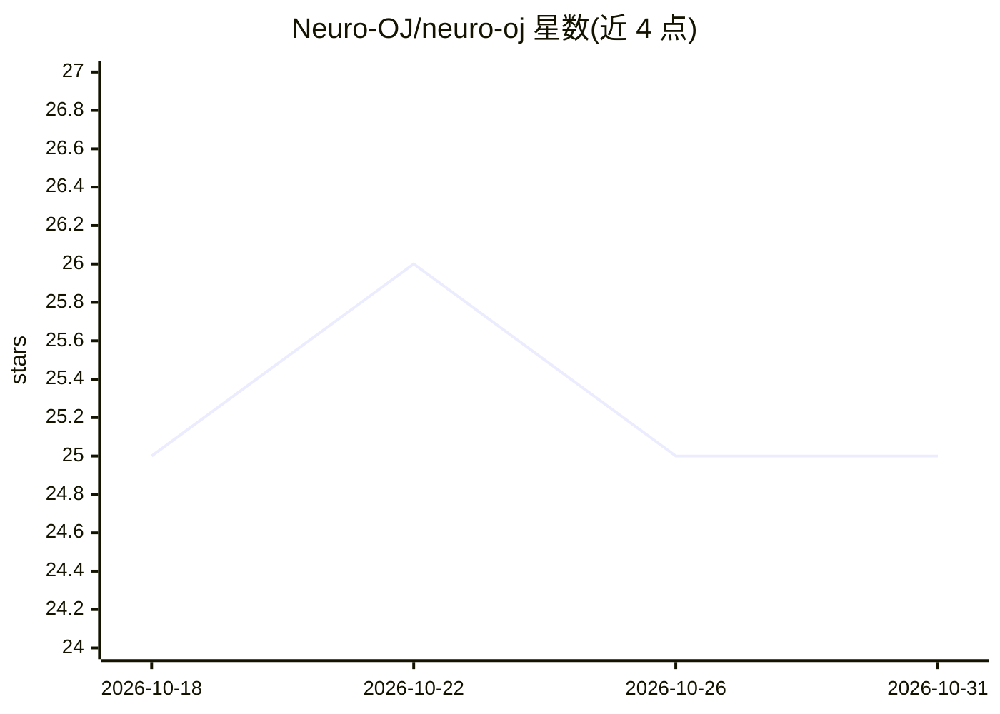

# Neuro-OJ/neuro-oj

⭐ 25 · TypeScript · AGPL-3.0 · 推送 2026-10-30 · [GitHub](https://github.com/Neuro-OJ/neuro-oj) · [官网](https://neuro-oj.icu) · 组织维护 · 中文 README

**面向 AI 认证与竞赛的开源在线评测平台（类 OJ）**

Neuro OJ 是独立社区开发的开源在线评测与竞赛平台，覆盖注册、做题、提交、评测全流程，适用于 LMCC 备考、AI 认证选拔、课程实训与模型评测竞赛。核心机制：函数调用型评测（evaluator 调用用户实现的函数并自定义评分，而非仅比较 stdin/stdout）、双容器 Docker 沙箱隔离、LLM 调用网关统一管理 Provider 与用量审计，以及排行榜、RBAC 权限等竞赛社区功能。README 明确声明仍处开发阶段、未经生产验证。生产环境通过 noj-cli 二进制 + Docker Compose 单机部署。

## 筛选速览

| 维度 | 判定 | 备注 |
|---|---|---|
| AI 角色 | `ai-ecosystem` | LLM/agent 周边工具 |
| 许可风险 | `viral` | AGPL-3.0 |
| 部署形态 | `self-host` | docker 或自建部署 |
| 模型依赖 | — | README 未给出锁定关系 |
| 硬件要求 | — | 无带数字的原话,不猜 |
| 安装摩擦 | `low` | 无编译、无系统依赖或容器化 |
| 成熟度 | `idea` | |

## 能力要点

- 函数调用型评测：evaluator 调用用户函数并自定义评分逻辑，覆盖客观题/代码题/LLM 工程题/产物提交题
- 双容器安全沙箱：用户代码与评测代码隔离，Solution 关闭网络
- LLM 调用网关：统一管理 Provider、凭据、限流与用量审计
- 题目按草稿→不可变版本发布，支持批量重测与有效版本策略

## 适用场景

- LMCC 备考与模拟训练、AI 认证与选拔
- 举办代码题与 LLM 工程题混合的评测竞赛
- 课程实训与模型评测竞赛（类 Kaggle 产物提交）

## 场景标签

`模型评测` · 领域:评测与运维

## 证据(README 行号)

> L28: 它与传统 OJ 的主要区别是：题目通过 evaluator
> L40: - **LLM 调用网关**：统一管理 Provider、访问凭据、限流与用量审计。

## 星数曲线

2026-10-18 25 → 2026-10-31 25（+0）

---
*卡片 v1 · prompt 1.4 · 生成 2026-10-27 · 置信度 high · 依据 README sha `64a65d0c9cc0` · [字段定义](../../DATASET.md)*
