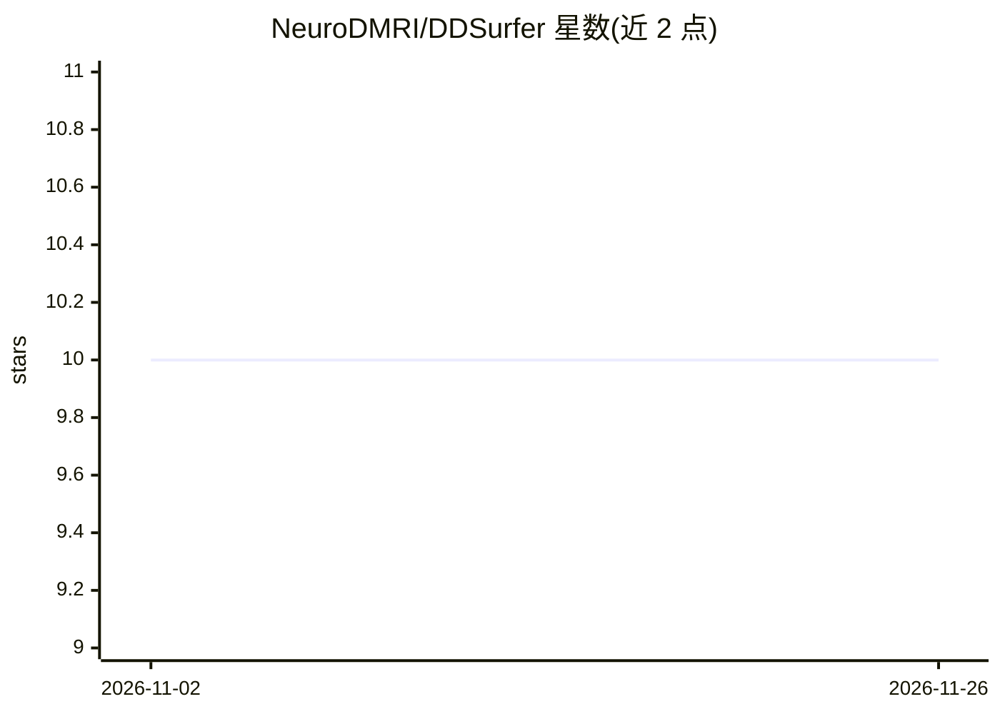

# NeuroDMRI/DDSurfer

⭐ 10 · Python · MIT · 推送 2026-11-25 · [GitHub](https://github.com/NeuroDMRI/DDSurfer) · 组织维护 · 中文 README

**从扩散 MRI 重建皮层表面的弱监督深度学习管线**

DDSurfer 提供从扩散 MRI 重建白质与软膜皮层表面的完整工作流：输入校正后的 4D DWI、bval、bvec 与脑掩膜，经 DTI 特征提取、MNI 推理生成双半球表面，可选 FreeSurfer 后处理与 3D Slicer 集成；模型权重随仓库提供并自动加载。支持 GPU/CPU 推理、FP32/BF16 精度选择、缓存复用与结果校验。面向神经影像研究者，需配置 Python 环境及 Slicer/SlicerDMRI 等外部组件。

## 筛选速览

| 维度 | 判定 | 备注 |
|---|---|---|
| AI 角色 | `ai-native` | 本体是模型或模型工具 |
| 许可风险 | `permissive` | MIT |
| 部署形态 | `library` | 以包/库形式分发 |
| 模型依赖 | — | README 未给出锁定关系 |
| 硬件要求 | — | 无带数字的原话,不猜 |
| 安装摩擦 | `high` | 编译与系统依赖俱全 |
| 成熟度 | — | 结构信号不足 |

## 能力要点

- 单条管线覆盖预处理、表面推理与可选后处理
- CUDA 与 CPU 双设备推理，FP32 默认、BF16 可选
- 缓存与 checksum 校验的断点复用（--resume）
- 后处理可接受其他方法生成的白质/软膜表面

## 适用场景

- 从 dMRI 数据重建皮层表面做表面分析
- 为皮层分区与区域统计生成 FreeSurfer 目录
- 对其他方法输出的表面做曲率、厚度等后处理

## 场景标签

`科研工具` · 领域:学习与行业

## 证据(README 行号)

> L14: DDSurfer reconstructs white and pial cortical surfaces from diffusion MRI.
> L44: DDSurfer framework: pseudo-ground-truth generation, dual-stream surface reconstruction, postprocessing and 3D Slice
> L87: python3 run_ddsurfer_pipeline.py --subject <subID>

## 星数曲线

2026-11-02 10 → 2026-11-26 10（+0）

---
*卡片 v1 · prompt 1.4 · 生成 2026-11-20 · 置信度 mid · 依据 README sha `f916fa646915` · [字段定义](../../DATASET.md)*
