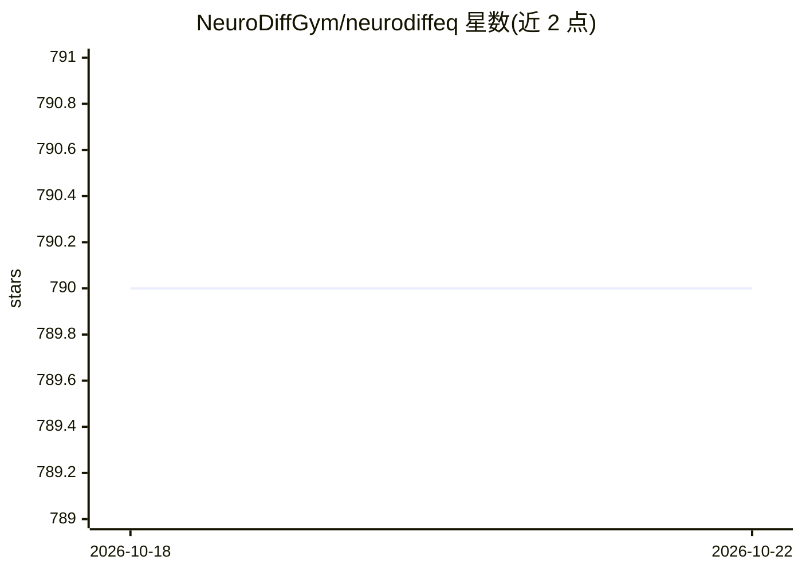

# NeuroDiffGym/neurodiffeq

⭐ 790 · Python · MIT · 推送 2026-04-22 · [GitHub](https://github.com/NeuroDiffGym/neurodiffeq) · [官网](http://pypi.org/project/neurodiffeq/) · 组织维护

**用神经网络求解微分方程的 PyTorch 库，供科研计算**

基于 PyTorch 的 Python 库，用人工神经网络作为函数逼近器求解常微分方程（ODE）与偏微分方程（PDE），支持初值/边值条件、ODE/PDE 系统、1D-2D 求解器与可视化 Monitor。支持自定义网络结构（任意 torch.nn.Module）、迁移学习、训练点采样策略（Generator 可拼接与升维）、解束（solution bundle）与逆问题求解。以 pip 安装提供，附文档与演示视频，要求引用两篇论文。

## 筛选速览

| 维度 | 判定 | 备注 |
|---|---|---|
| AI 角色 | `ai-native` | 本体是模型或模型工具 |
| 许可风险 | `permissive` | MIT |
| 部署形态 | `library` | 以包/库形式分发 |
| 模型依赖 | — | README 未给出锁定关系 |
| 硬件要求 | — | 无带数字的原话,不猜 |
| 安装摩擦 | `medium` | 含编译或系统依赖之一 |
| 成熟度 | — | 结构信号不足 |

## 能力要点

- 神经网络求解 ODE/PDE，支持初值与边值条件及方程组
- BundleSolver 支持一次求解方程束并处理逆问题（如反推反应速率）
- 训练点采样 Generator 支持 uniform/log-spaced 等分布、拼接与高维组合
- 兼容任意自定义 torch.nn.Module 网络与迁移学习

## 适用场景

- 科研与工程中求非线性 ODE/PDE 的连续可微数值解
- 化学动力学等场景中反推方程参数（逆问题）
- 在 Jupyter 中训练并实时监控解与损失曲线

## 场景标签

 · 领域:科学计算/物理信息神经网络（PINN）

## 证据(README 行号)

> L22: `neurodiffeq` is a package for solving differential equations with neural networks. Differential equations are equa
> L24: As universal function approximators, artificial neural networks have been shown to have the potential to solve ordi

## 星数曲线

2026-10-18 790 → 2026-10-22 790（+0）

---
*卡片 v1 · prompt 1.4 · 生成 2026-10-21 · 置信度 high · 依据 README sha `28670c8edafd` · [字段定义](../../DATASET.md)*
