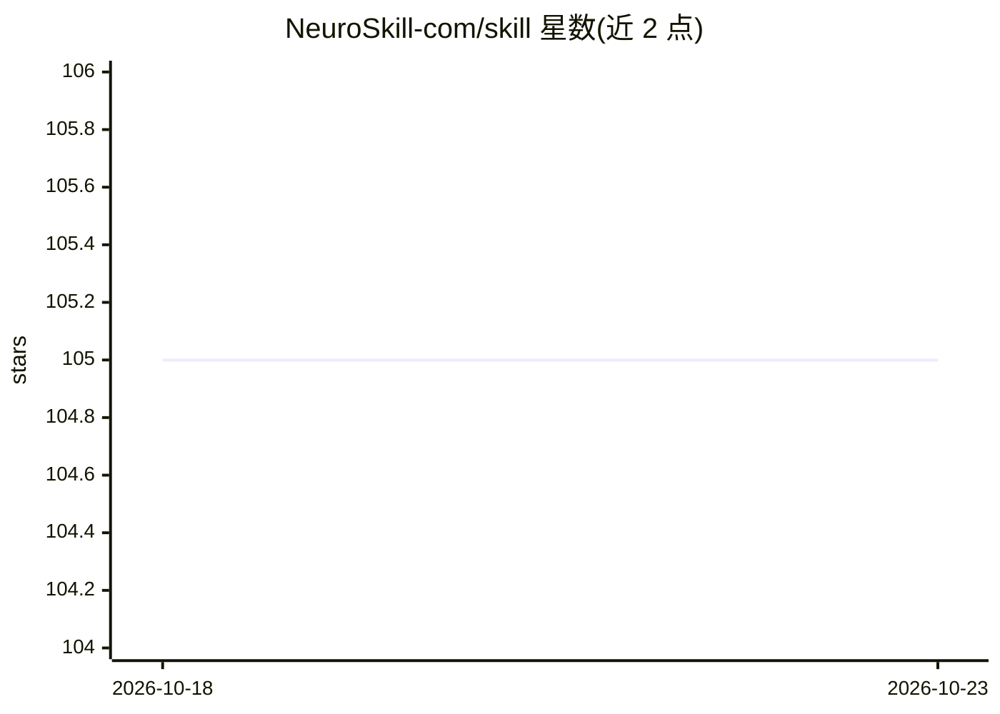

# NeuroSkill-com/skill

⭐ 105 · Rust · GPL-3.0 · 推送 2026-10-12 · [GitHub](https://github.com/NeuroSkill-com/skill) · [官网](https://neuroskill.com) · 组织维护

**本地优先的桌面神经反馈与 BCI 研究工具**

基于 Tauri v2 (Rust) 与 SvelteKit 构建的本地桌面应用，面向 EXG/BCI 研究者：实时流式传输并可视化 18 家厂商的 EEG/EXG 设备数据及任意 LSL 来源，提供 GPU 频段功率分析、神经嵌入、睡眠分期、UMAP 可视化与相似度检索，支持加载 20 种 EXG/BCI 基础模型，内置本地 LLM 与 TTS 集成及 WebSocket/HTTP API。README 明确声明仅供研究、非医疗器械、未经 FDA/CE 认证。提供三平台安装包与 Homebrew 安装。

## 筛选速览

| 维度 | 判定 | 备注 |
|---|---|---|
| AI 角色 | `ai-native` | 本体是模型或模型工具 |
| 许可风险 | `viral` | GPL-3.0 |
| 部署形态 | `None` |  |
| 模型依赖 | — | README 未给出锁定关系 |
| 硬件要求 | — | 无带数字的原话,不猜 |
| 安装摩擦 | `low` | 无编译、无系统依赖或容器化 |
| 成熟度 | — | 结构信号不足 |

## 能力要点

- 实时 EXG 流式传输与可视化，支持 18 家厂商设备及任意 LSL 来源
- GPU 频段功率分析 + 神经嵌入 + UMAP 可视化与睡眠分期
- 支持 20 种 EXG/BCI 基础模型（ZUNA、LaBraM、EEGPT 等）
- 本地 LLM + TTS 集成，WebSocket/HTTP API

## 适用场景

- 连接消费级或科研级 EEG 设备进行实时数据采集与可视化
- 对脑电会话做睡眠分期、相似度检索与会话对比
- 在本地运行 EXG 基础模型提取神经嵌入并做下游分析

## 场景标签

`科研工具` · 领域:学习与行业

## 证据(README 行号)

> L12: NeuroSkill is a local-first desktop neurofeedback + BCI app built with **Tauri v2 (Rust)** and **SvelteKit**.
> L27: - GPU band-power analysis + neural embeddings
> L30: - Local LLM + TTS integration

## 星数曲线

2026-10-18 105 → 2026-10-23 105（+0）

---
*卡片 v1 · prompt 1.4 · 生成 2026-10-23 · 置信度 high · 依据 README sha `dabc29a64ab1` · [字段定义](../../DATASET.md)*
