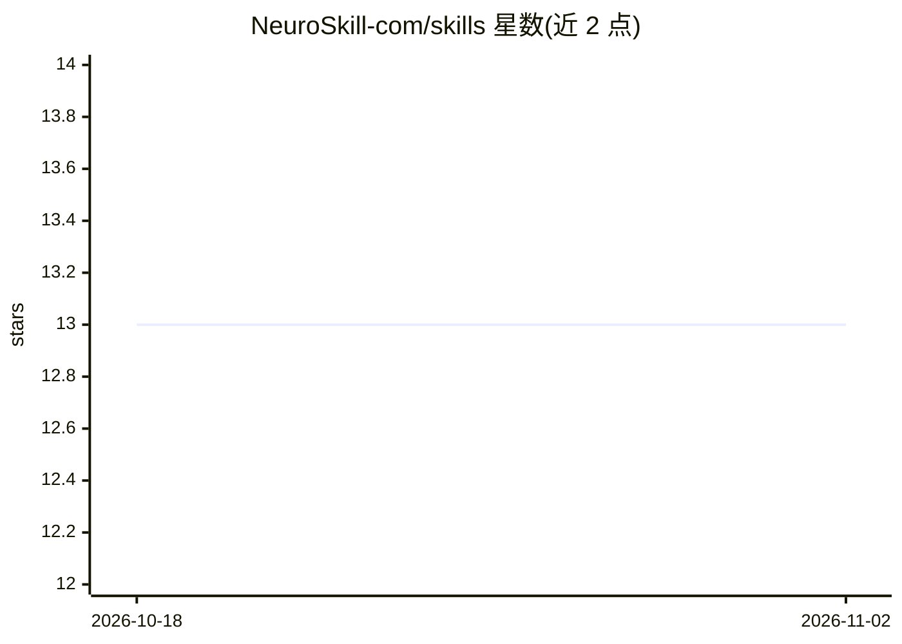

# NeuroSkill-com/skills

⭐ 13 · NOASSERTION · 推送 2026-10-26 · [GitHub](https://github.com/NeuroSkill-com/skills) · [官网](https://neuroskill.com) · 组织维护

**NeuroLoop 生物信号 AI 伴侣的 EXG 技能文档集合**

一个 npm 包形式的 markdown 技能集合，为 NeuroLoop——由实时 EXG 设备（Muse 或 OpenBCI）驱动的生物特征 AI 伴侣——提供技能文件。技能分三类：EXG 数据与 API（状态快照、会话指标、睡眠分期、标签语义检索、流式事件、截图-EEG 交叉检索等）、LLM 与 AI（设备端 LLM 推理服务器，OpenAI 兼容 API）、协议与干预（专注/压力/情绪/睡眠等 11 个领域子技能）。加载机制为 harness 按用户消息领域匹配后把技能文件注入系统提示词，并附 8 个 agent 工具说明。安装通过 npx skills add 完成。

## 筛选速览

| 维度 | 判定 | 备注 |
|---|---|---|
| AI 角色 | `ai-knowledge` | 知识聚合/清单类 |
| 许可风险 | `none` | NOASSERTION |
| 部署形态 | `library` | 以包/库形式分发 |
| 模型依赖 | — | README 未给出锁定关系 |
| 硬件要求 | — | 无带数字的原话,不猜 |
| 安装摩擦 | `low` | 无编译、无系统依赖或容器化 |
| 成熟度 | — | 结构信号不足 |

## 能力要点

- 三类技能：EXG 数据/API、LLM 推理、11 领域协议框架
- 上下文加载：按消息领域信号将技能文件注入系统提示词
- 覆盖睡眠分期、UMAP 投影、跨模态 EEG↔截图检索等命令文档
- 以 npm 包分发，npx skills add 安装

## 适用场景

- 为 NeuroLoop 伴侣 agent 添加 EXG 数据读取与协议干预技能
- 查阅 EXG 指标字段参考与脚本化配方
- 了解 harness 如何按领域动态注入技能

## 场景标签

`提示工程` · 领域:Agent 开发

## 证据(README 行号)

> L8: A collection of NeuroSkill EXG skills for NeuroLoop™️ — a biometric AI companion powered by a real-time EXG device (
> L62: ## How Contextual Loading Works
> L64: On every user message the harness:

## 星数曲线

2026-10-18 13 → 2026-11-02 13（+0）

---
*卡片 v1 · prompt 1.4 · 生成 2026-10-31 · 置信度 high · 依据 README sha `79fb8e878dfc` · [字段定义](../../DATASET.md)*
