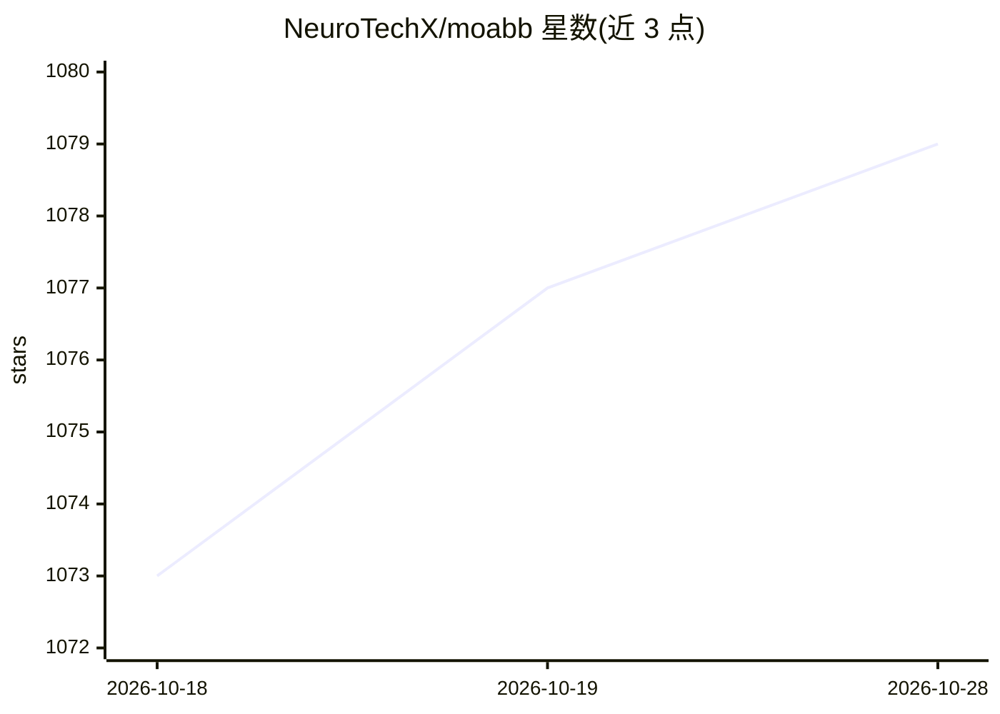

# NeuroTechX/moabb

⭐ 1,079 · Python · BSD-3-Clause · 推送 2026-10-27 · [GitHub](https://github.com/NeuroTechX/moabb) · [官网](https://moabb.neurotechx.com/docs/index.html) · 组织维护

**脑机接口算法基准测试框架：统一评测 BCI 算法**

面向脑机接口（BCI）研究的基准测试框架：在多个公开 EEG 数据集上运行和评测流行的 BCI 算法，支持算法排名对比，代码作为后续算法开发的参考点。以 Python 包形式提供（pip install moabb），内置数据集接口与跨会话评测等评估流程。由 NeuroTechX 社区下的核心团队维护，附有基准论文（Journal of Neural Engineering 2018 与后续复现性研究）供引用。

## 筛选速览

| 维度 | 判定 | 备注 |
|---|---|---|
| AI 角色 | `ai-ecosystem` | LLM/agent 周边工具 |
| 许可风险 | `permissive` | BSD-3-Clause |
| 部署形态 | `library` | 以包/库形式分发 |
| 模型依赖 | — | README 未给出锁定关系 |
| 硬件要求 | — | 无带数字的原话,不猜 |
| 安装摩擦 | `low` | 无编译、无系统依赖或容器化 |
| 成熟度 | — | 结构信号不足 |

## 能力要点

- 在多个公开 EEG 数据集上构建 BCI 算法综合基准
- 提供数据集接口（如 BNCI2014_001）与评测流程（如 CrossSessionEvaluation）
- 支持算法排名与结果展示，代码作为算法开发参考点
- PyPI 发布，附软件与科学论文引用格式

## 适用场景

- 在统一基准上评测自研 BCI 算法并与已有算法对比
- 复现文献中的 BCI 算法结果
- 查找公开 EEG 数据集并运行标准化评测流程

## 场景标签

`模型评测` `科研工具` · 领域:评测与运维

## 证据(README 行号)

> L9:  Build a comprehensive benchmark of popular Brain-Computer Interface (BCI) algorithms applied on an extensive list
> L69: - Build a comprehensive benchmark of popular BCI algorithms applied on an extensive list

## 星数曲线

2026-10-18 1,073 → 2026-10-28 1,079（+6）

---
*卡片 v1 · prompt 1.4 · 生成 2026-10-21 · 置信度 high · 依据 README sha `471958a624b3` · [字段定义](../../DATASET.md)*
