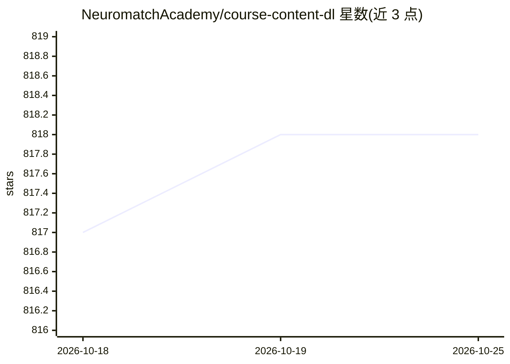

# NeuromatchAcademy/course-content-dl

⭐ 818 · Jupyter Notebook · CC-BY-4.0 · 推送 2026-07-07 · [GitHub](https://github.com/NeuromatchAcademy/course-content-dl) · [官网](https://deeplearning.neuromatch.io/) · 组织维护

**Neuromatch Academy 深度学习课程内容库：代码优先的教学大纲与教程**

Neuromatch Academy（NMA-DL）深度学习课程的公开内容仓库，覆盖深度学习理论与实践教学：如何判断哪些问题适合深度学习、如何选择与实现模型、如何可视化和论证结果，以及神经科学对深度学习的启发，并强调深度学习的伦理使用。内容主要经由配套电子书访问，仓库内含每日课程表与教程，面向希望获得动手编码经验的学员与教学贡献者。内容采用 CC BY 4.0 许可，软件部分附加 BSD-3 许可。

## 筛选速览

| 维度 | 判定 | 备注 |
|---|---|---|
| AI 角色 | `ai-knowledge` | 知识聚合/清单类 |
| 许可风险 | `viral` | CC-BY-4.0 |
| 部署形态 | `None` |  |
| 模型依赖 | — | README 未给出锁定关系 |
| 硬件要求 | — | 无带数字的原话,不猜 |
| 安装摩擦 | `low` | 无编译、无系统依赖或容器化 |
| 成熟度 | — | 结构信号不足 |

## 能力要点

- 代码优先的深度学习课程大纲与教程内容
- 覆盖 CNN/RNN/Transformer/强化学习等主题（据仓库标签）
- 配套电子书与每日课程表
- 接受社区贡献（all-contributors 规范）

## 适用场景

- 系统学习深度学习理论与实践，动手写代码
- 查看课程安排与先修要求以准备参课
- 基于 CC BY 许可复用课程内容开展教学

## 场景标签

`教程课程` · 领域:学习与行业

## 证据(README 行号)

> L1: # Neuromatch Academy Deep Learning (NMA-DL) syllabus
> L7: **Objectives**: Gain hands-on, code-first experience with deep learning theories, models, and skills that are useful
> L11: The content should primarily be accessed from our ebook: https://deeplearning.neuromatch.io/ [under continuous deve

## 星数曲线

2026-10-18 817 → 2026-10-25 818（+1）

---
*卡片 v1 · prompt 1.4 · 生成 2026-10-21 · 置信度 high · 依据 README sha `ab2c949ed9b3` · [字段定义](../../DATASET.md)*
