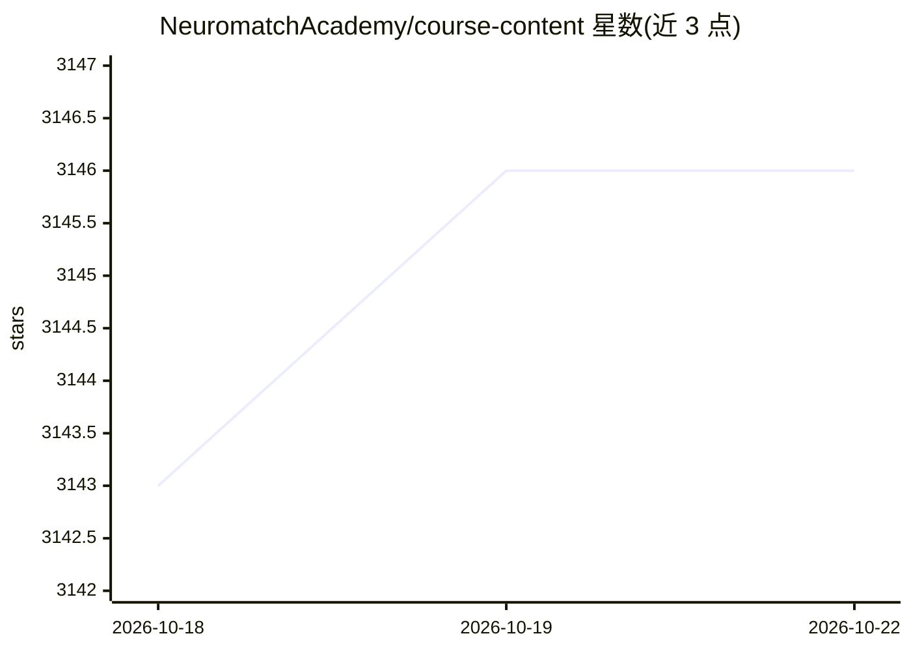

# NeuromatchAcademy/course-content

⭐ 3,145 · Jupyter Notebook · CC-BY-4.0 · 推送 2026-09-18 · [GitHub](https://github.com/NeuromatchAcademy/course-content) · [官网](https://compneuro.neuromatch.io) · 组织维护

**计算神经科学暑期课程教材（教程与日程），面向学生**

Neuromatch Academy 2025 年（7 月 7-25 日）计算神经科学课程的课程内容仓库，涵盖动力系统、随机过程、机器学习与神经科学主题的教程与每日日程。内容主要通过配套电子书访问（compneuro.neuromatch.io），仓库提供日程文件与教程材料，README 给出先修要求入口。文本内容以 CC BY 4.0 共享，软件元素附加 BSD-3 许可，衍生作品可自行选择合适许可。

## 筛选速览

| 维度 | 判定 | 备注 |
|---|---|---|
| AI 角色 | `ai-knowledge` | 知识聚合/清单类 |
| 许可风险 | `viral` | CC-BY-4.0 |
| 部署形态 | `None` |  |
| 模型依赖 | — | README 未给出锁定关系 |
| 硬件要求 | — | 无带数字的原话,不猜 |
| 安装摩擦 | `low` | 无编译、无系统依赖或容器化 |
| 成熟度 | — | 结构信号不足 |

## 能力要点

- 2025 年 7 月 7-25 日计算神经科学课程内容
- 主题覆盖动力系统、随机过程、机器学习、神经科学
- 主要通过配套电子书持续更新发布
- 内容 CC BY 4.0、软件 BSD-3 双许可

## 适用场景

- 按日程自学计算神经科学课程
- 查找动力系统/随机过程等主题的教程材料
- 基于课程内容创作衍生教材

## 场景标签

`教程课程` · 领域:学习与行业

## 证据(README 行号)

> L1: # NeuroMatch Academy (NMA) Computational Neuroscience syllabus
> L9: **The content should primarily be accessed from our ebook: https://compneuro.neuromatch.io/ [under continuous develo

## 星数曲线

2026-10-18 3,143 → 2026-10-22 3,146（+3）

---
*卡片 v1 · prompt 1.4 · 生成 2026-10-20 · 置信度 high · 依据 README sha `7cc4e2998ea4` · [字段定义](../../DATASET.md)*
