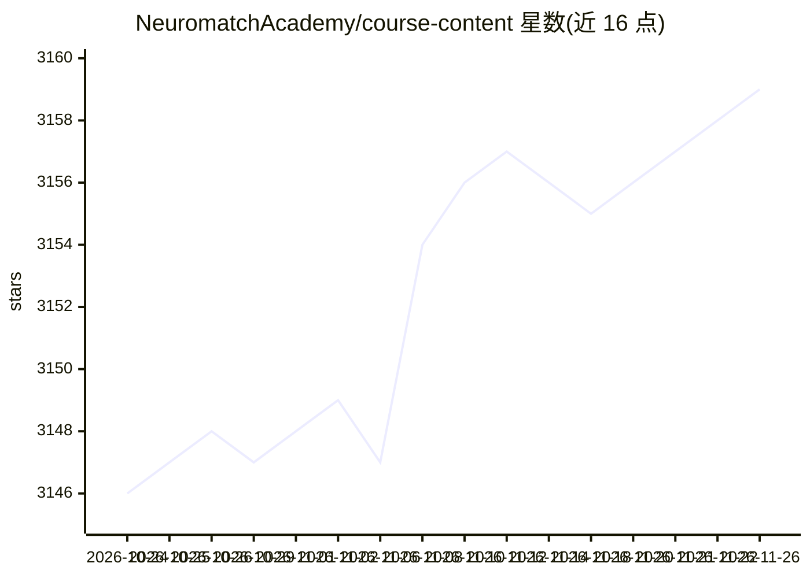

# NeuromatchAcademy/course-content

⭐ 3,159 · Jupyter Notebook · CC-BY-4.0 · 推送 2026-11-12 · [GitHub](https://github.com/NeuromatchAcademy/course-content) · [官网](https://compneuro.neuromatch.io) · 组织维护

**计算神经科学课程的教学内容仓库（含教程代码）**

Neuromatch Academy 计算神经科学课程的教学材料仓库，主要内容包括按日程组织的教程与配套代码。仓库本体仅提供课程大纲、日程表链接、前置知识说明与贡献者名单，内容主体指向其在线电子书阅读。内容采用 CC BY 4.0 许可，软件部分额外采用 BSD 3-Clause 许可，衍生作品可任选其一。面向参加其线上课程或自学的学习者。

## 筛选速览

| 维度 | 判定 | 备注 |
|---|---|---|
| AI 角色 | `ai-knowledge` | 知识聚合/清单类 |
| 许可风险 | `viral` | CC-BY-4.0 |
| 部署形态 | `None` |  |
| 模型依赖 | — | README 未给出锁定关系 |
| 硬件要求 | — | 无带数字的原话,不猜 |
| 安装摩擦 | `low` | 无编译、无系统依赖或容器化 |
| 成熟度 | — | 结构信号不足 |

## 能力要点

- 教程内容持续开发中，主要从配套电子书访问
- 提供按日组织的课程日程表
- 内容 CC BY 4.0、软件 BSD 3-Clause 双许可

## 适用场景

- 跟随 Neuromatch 课程学习计算神经科学
- 查阅课程教程代码作为学习参考

## 场景标签

`教程课程` · 领域:学习与行业

## 证据(README 行号)

> L1: # NeuroMatch Academy (NMA) Computational Neuroscience syllabus
> L9: **The content should primarily be accessed from our ebook: https://compneuro.neuromatch.io/ [under continuous develo

## 星数曲线

2026-10-24 3,146 → 2026-11-26 3,159（+13）

---
*卡片 v1 · prompt 1.4 · 生成 2026-11-23 · 置信度 high · 依据 README sha `ac352d50d585` · [字段定义](../../DATASET.md)*
